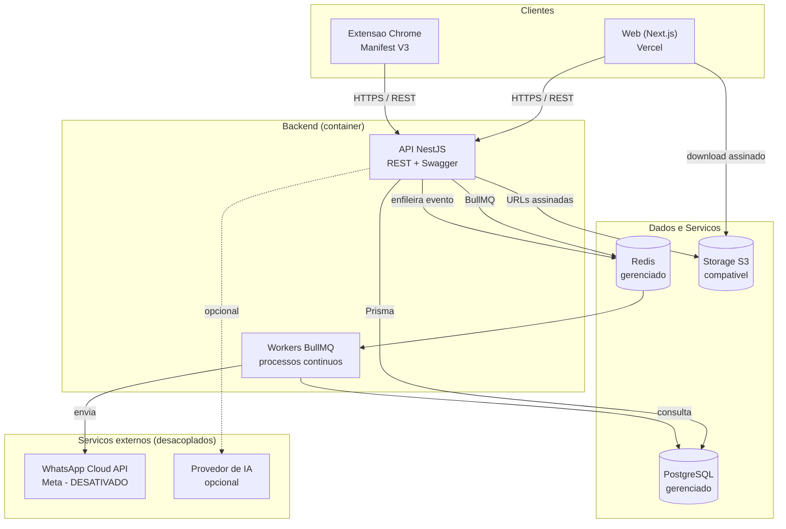
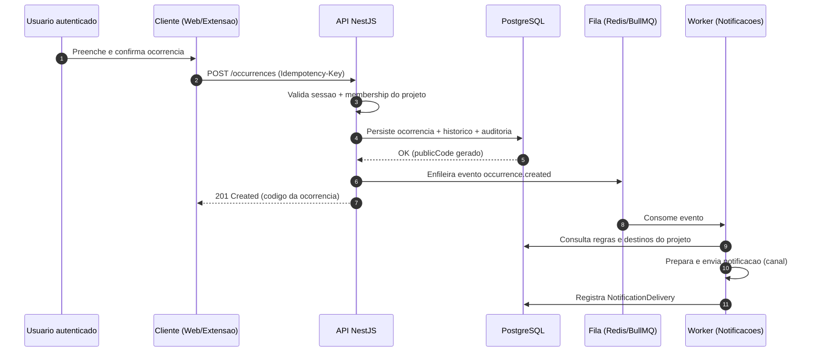

# Arquitetura Geral

**Versão:** 1.1
**Data:** 21/11/2026
**Status:** Implementado (Etapas 1 a 10; Etapa 11 — Deploy em preparação, sem deploy de produção)

---

## 1. Visão geral

O QUALITY TEST é uma plataforma corporativa **multi-projeto** para registro e acompanhamento de testes, bugs, inconsistências e problemas de homologação. A arquitetura proposta segue um modelo **cliente-servidor** com:

- **Frontend** Next.js (App Router) hospedado na Vercel.
- **API** NestJS (REST) executando em container, com persistência real.
- **Workers** BullMQ persistentes para tarefas assíncronas (ex.: notificações).
- **Banco** PostgreSQL gerenciado externamente.
- **Cache/Fila** Redis gerenciado externamente.
- **Storage** S3-compatível para screenshots e anexos.
- **Extensão Chrome** Manifest V3 consumindo a mesma API.

> Conteúdo revisado em 21/11/2026 para refletir a arquitetura **implementada** (Etapas 1 a 10; Etapa 11 — Deploy em preparação). Nenhum ambiente de produção foi provisionado.

---

## 2. Princípios arquiteturais

1. **Isolamento lógico por projeto em todas as camadas** — API, consultas, serviços de negócio, dashboard, listagens, pesquisa, exportações, relatórios, comentários, anexos, notificações e extensão. O filtro visual no frontend **não** é suficiente; a autorização é validada no backend em toda operação.
2. **Usuário único, múltiplos projetos** — relacionamento muitos-para-muitos via `ProjectMember`, sem contas duplicadas.
3. **Autoria determinada no servidor** — nunca aceitar `userId` enviado livremente pelo cliente.
4. **Desacoplamento de módulos opcionais** — WhatsApp (notificação) e IA são módulos separados. A indisponibilidade deles não pode impedir o funcionamento básico.
5. **Rastreabilidade e auditoria** — histórico de alterações e trilha de auditoria desde o MVP.
6. **Segurança por padrão** — RBAC + permissões por projeto, hash de senha, sessões protegidas, validação de entrada, CORS restrito, rate limiting, URLs assinadas com expiração.
7. **Simplicidade** — não criar abstrações ou serviços adicionais sem necessidade.

---

## 3. Stack tecnológica (seção 12 da especificação)

| Camada | Tecnologias |
|---|---|
| **Frontend** | Next.js (App Router), React, TypeScript strict, Tailwind CSS, shadcn/ui, TanStack Query, React Hook Form, Zod |
| **Backend** | Node.js, NestJS, TypeScript, REST API, Prisma ORM, Swagger/OpenAPI |
| **Dados** | PostgreSQL |
| **Filas** | Redis, BullMQ |
| **Extensão** | Chrome Manifest V3, TypeScript, React (se adequado) |
| **Armazenamento** | S3 ou compatível, URLs assinadas, validação de tipo e tamanho, varredura de arquivos quando viável |
| **Testes** | Jest ou Vitest (conforme compatibilidade), Supertest, Playwright, testes de extensão e integração |

---

## 4. Estrutura de diretórios do monorepositório (seção 12)

Estrutura sugerida pela especificação, representada como árvore. Ajustes poderão ocorrer se houver justificativa técnica.

```text
qualitytest/
├── apps/
│   ├── web/            # Frontend Next.js (App Router)
│   ├── api/            # Backend NestJS (REST)
│   ├── extension/      # Extensão Chrome (Manifest V3 + TypeScript)
│   └── worker/         # Workers BullMQ (processos contínuos)
├── packages/
│   ├── shared/         # Código compartilhado (regras, utilitários)
│   ├── types/          # Tipos compartilhados
│   └── config/         # Configurações compartilhadas (lint, tsconfig)
├── infrastructure/     # Definições de infraestrutura
├── docker/             # Dockerfiles e docker-compose (dev)
├── scripts/            # Scripts auxiliares
└── docs/
    ├── architecture/   # Arquitetura, C4, ER, ADRs, planos
    │   ├── adr/        # Decisões arquiteturais (ADRs)
    │   └── diagrams/   # Diagramas (Mermaid e exportações)
    ├── api/            # Contratos e OpenAPI
    ├── user-guides/    # Manuais de uso por perfil
    └── operations/     # Deploy, backups, runbooks, troubleshooting
```

> A pasta `docs/` é obrigatória e deve ser mantida durante todo o desenvolvimento (seção 17).

---

## 5. Diagrama de arquitetura geral



---

## 6. Fluxo de alto nível (registro de ocorrência)



---

## 7. Requisitos não funcionais relevantes

| Categoria | Diretriz |
|---|---|
| **Isolamento** | Toda operação valida `ProjectMember` do usuário autenticado |
| **Segurança** | Hash de senha, refresh tokens protegidos, CORS restrito, rate limiting, headers de segurança, HTTPS |
| **Privacidade (LGPD)** | Minimização de dados, retenção definida, cuidado com dados pessoais em screenshots |
| **Resiliência** | Ocorrência salva antes de notificar; WhatsApp não bloqueia o registro |
| **Observabilidade** | Logs e monitoramento para frontend, API e workers; logs sem credenciais |
| **Testabilidade** | Unitário, integração, API e E2E, com foco em testes de isolamento |

---

## 8. Referências

- Especificação mestra, seções 1, 2, 12, 13, 14, 17.
- [c4.md](c4.md)
- [modelo-de-dados.md](modelo-de-dados.md)
- [permissoes-e-isolamento.md](permissoes-e-isolamento.md)
- [deploy-infraestrutura.md](deploy-infraestrutura.md)
- [adr/ADR-0001-stack-e-monorepo.md](adr/ADR-0001-stack-e-monorepo.md)
