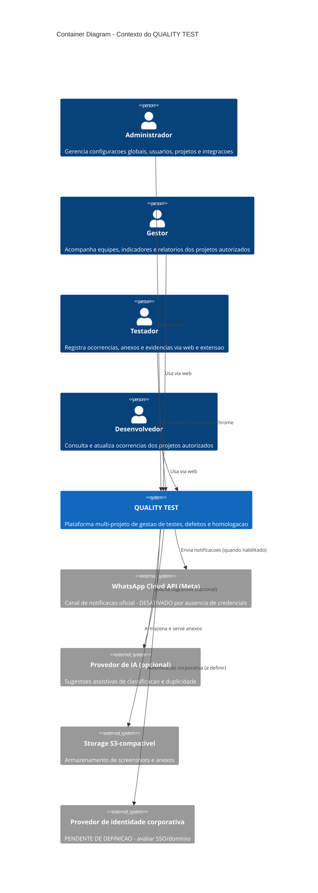
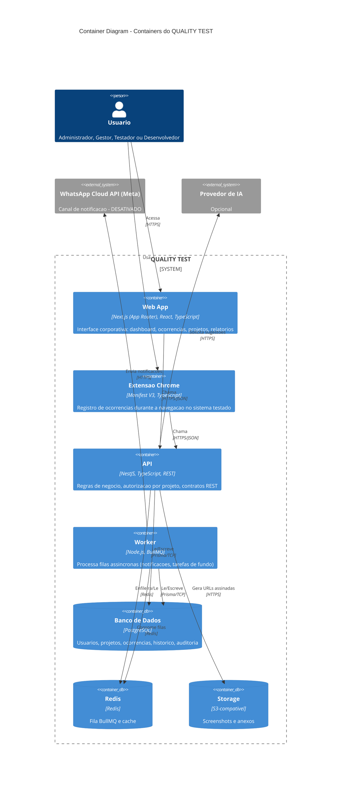

# Diagramas C4 (Contexto, Containers e Componentes)

**Versão:** 1.1
**Data:** 21/11/2026
**Status:** Implementado (Etapas 1 a 10; Etapa 11 — Deploy em preparação)

---

## 1. Objetivo

Apresentar os três níveis clássicos do modelo C4 para o QUALITY TEST, com diagramas Mermaid editáveis:

1. **Nível 1 — Contexto:** o sistema e suas relações com pessoas e sistemas externos.
2. **Nível 2 — Containers:** os contêineres/processos que compõem a plataforma.
3. **Nível 3 — Componentes:** decomposição da API NestJS.

> Diagramas revisados em 21/11/2026 para refletir a arquitetura **implementada**. Os contêineres de produção (Vercel, PostgreSQL, Redis e storage gerenciados) seguem **PENDENTE DE DEFINIÇÃO**.

---

## 2. Nível 1 — Diagrama de Contexto

Mostra quem usa o sistema e quais sistemas externos ele consome.

---

## 3. Nível 2 — Diagrama de Containers

Detalha os contêineres que executam ou armazenam dados. Cada container é descrito na seção 5.

---

## 4. Nível 3 — Diagrama de Componentes (API NestJS)

Decomposição da API em módulos/componentes internos.

```mermaid
C4Component
    title Component Diagram - API NestJS

    Container_Boundary(api, "API NestJS") {
        Component(auth, "AuthModule", "NestJS", "Login, logout, refresh, sessoes, recuperacao de senha")
        Component(users, "UsersModule", "NestJS", "Gestao de usuarios e perfis globais")
        Component(projects, "ProjectsModule", "NestJS", "CRUD de projetos, ambientes, dominios e membros")
        Component(occurr, "OccurrencesModule", "NestJS", "Cadastro, listagem, detalhes, anexos, comentarios, status")
        Component(history, "HistoryModule", "NestJS", "Historico cronologico de alteracoes")
        Component(audit, "AuditModule", "NestJS", "Trilha de auditoria imutavel para usuarios comuns")
        Component(notif, "NotificationsModule", "NestJS", "Regras e destinos; publica eventos na fila")
        Component(reports, "ReportsModule", "NestJS", "Indicadores e relatorios respeitando escopo de acesso")
        Component(ai, "AiModule (opcional)", "NestJS", "Sugestoes assistivas de IA; desativavel (AI_ENABLED)")
        Component(storagec, "StorageModule", "NestJS", "URLs assinadas e validacao de tipo/tamanho")

        Component(guard, "AuthGuard + ProjectGuard", "NestJS", "Valida sessao e membership por projeto em toda operacao")
        Component(policy, "PolicyService", "NestJS", "RBAC combinado com permissoes por projeto")
        Component(prisma, "PrismaService", "NestJS", "Acesso ao PostgreSQL")
    }

    ContainerDb(db, "PostgreSQL", "PostgreSQL")
    ContainerDb(cacheq, "Redis/BullMQ", "Redis")
    ContainerDb(storage, "S3", "S3-compativel")
    System_Ext(wa, "WhatsApp Cloud API", "Meta")
    System_Ext(iaprov, "Provedor de IA", "Opcional")

    Component(worker, "Worker BullMQ", "Node.js")

    Rel(auth, prisma, "Persiste sessoes")
    Rel(users, prisma, "Le/Escreve")
    Rel(projects, prisma, "Le/Escreve")
    Rel(occurr, prisma, "Le/Escreve")
    Rel(history, prisma, "Le/Escreve")
    Rel(audit, prisma, "Escreve")
    Rel(reports, prisma, "Le (escopo por projeto)")
    Rel(occurr, storagec, "Usa")
    Rel(occurr, notif, "Emite evento")
    Rel(notif, cacheq, "Enfileira")
    Rel(ai, iaprov, "Solicita sugestao")
    Rel(guard, policy, "Consulta permissoes")
    Rel(prisma, db, "Acesso SQL")
    Rel(storagec, storage, "URLs assinadas")
    Rel(cacheq, worker, "Consome")
    Rel(worker, wa, "Envia")
```

---

## 5. Descrição dos containers

| Container | Tecnologia | Responsabilidade | Notas |
|---|---|---|---|
| **Web App** | Next.js (App Router), React, TypeScript strict | Interface corporativa: dashboard, projetos, ocorrencias, relatorios, gestao | Deploy na Vercel |
| **Extensao Chrome** | Manifest V3 + TypeScript | Registro de ocorrencias durante a navegacao; captura de screenshot; sugestao de projeto por dominio com confirmacao | Usa a sessao autenticada do Quality Test |
| **API** | NestJS, REST, Prisma, Swagger/OpenAPI | Regras de negocio, autorizacao por projeto, contratos REST, validacao, tratamento de erros | Executa em container; nao assumir execucao completa na Vercel |
| **Worker** | Node.js, BullMQ | Processos continuos: consumo de filas (notificacoes, reprocessamento) | Requer infraestrutura com processos persistentes |
| **Banco de Dados** | PostgreSQL | Persistencia de usuarios, projetos, ocorrencias, historico, auditoria | Servico gerenciado externo |
| **Redis** | Redis | Fila BullMQ e cache | Servico gerenciado externo |
| **Storage** | S3-compativel | Screenshots e anexos, com URLs assinadas | Validacao de MIME/tamanho; varredura quando viavel |

---

## 6. Sistemas externos

| Sistema | Papel | Estado |
|---|---|---|
| WhatsApp Cloud API (Meta) | Canal de notificacao oficial | **Desativado** (sem credenciais) — PENDENTE DE DEFINIÇÃO |
| Provedor de IA | Sugestoes assistivas opcionais | PENDENTE DE DEFINIÇÃO |
| Storage S3-compativel | Anexos | PENDENTE DE DEFINIÇÃO |
| Provedor de identidade corporativa (SSO) | Avaliar autenticacao corporativa | PENDENTE DE DEFINIÇÃO |

---

## 7. Referências

- [arquitetura-geral.md](arquitetura-geral.md)
- [contratos-api.md](contratos-api.md)
- [notificacoes-whatsapp.md](notificacoes-whatsapp.md)
- [deploy-infraestrutura.md](deploy-infraestrutura.md)
