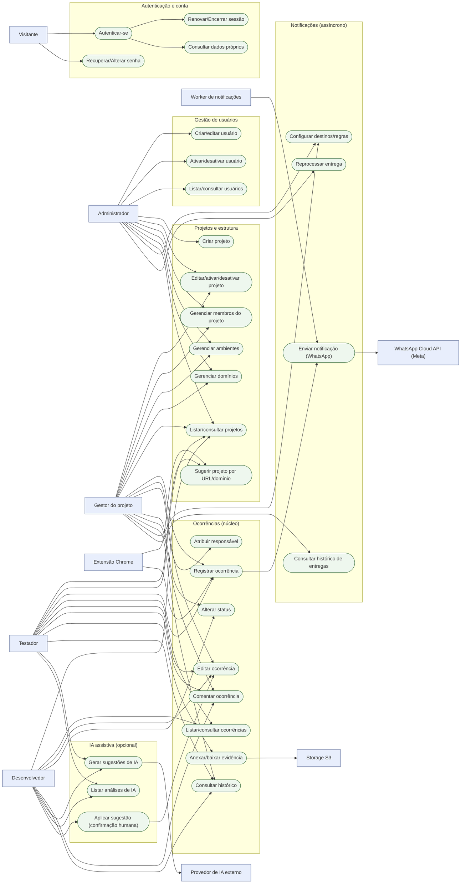
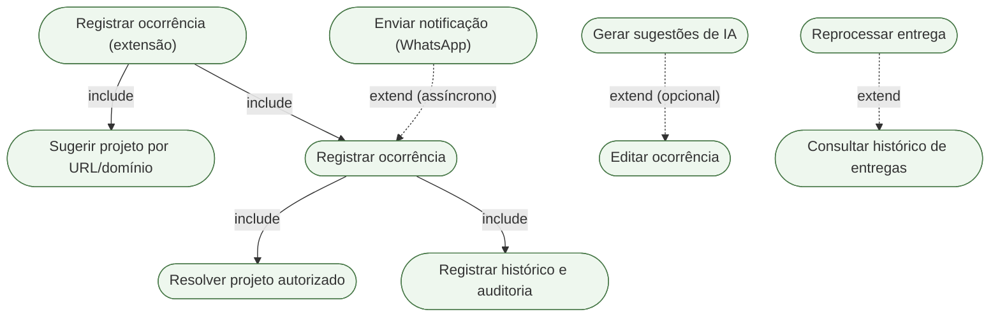

# Casos de Uso

**Versão:** 1.0
**Data:** 21/11/2026
**Status:** Implementado

---

## 1. Objetivo

Apresentar o **diagrama de casos de uso** do QUALITY TEST (item da seção **17.2** da especificação mestra), com os atores, os casos de uso e seus relacionamentos (`include`/`extend`). O conteúdo reflete **apenas o sistema efetivamente implementado** — cada caso de uso é rastreável a endpoints reais da API (ver seção 7).

> Diagramas em Mermaid, editáveis no Markdown. Nenhum caso de uso "futuro" é apresentado como implementado: os itens planejados aparecem explicitamente marcados.

---

## 2. Atores

### 2.1 Atores primários (humanos)

| Ator | Escopo | Descrição |
|---|---|---|
| **Visitante** | Global | Usuário não autenticado. Apenas autentica-se ou solicita redefinição de senha. |
| **Administrador** | Global (`GlobalRole.ADMINISTRADOR`) | Administra a plataforma: usuários, projetos, permissões, integrações e auditoria. Consulta todos os projetos. |
| **Gestor** | Por projeto (`ProjectRole.GESTOR`) | Atua nos projetos em que tem vínculo ativo: gerencia ocorrências, responsáveis, membros, ambientes, domínios e notificações. |
| **Testador** | Por projeto (`ProjectRole.TESTADOR`) | Registra ocorrências, anexa evidências e acompanha ocorrências dos projetos autorizados. |
| **Desenvolvedor** | Por projeto (`ProjectRole.DESENVOLVEDOR`) | Consulta e atualiza ocorrências permitidas/atribuídas, registra análise técnica e atualiza status conforme o fluxo autorizado. |

> Capacidades detalhadas por papel na [matriz de permissões](permissoes-e-isolamento.md#4-matriz-de-permissões-recurso--papel).

### 2.2 Atores de apoio (clientes/automáticos)

| Ator | Descrição |
|---|---|
| **Extensão Chrome** | Cliente MV3 que registra ocorrências a partir da aba do sistema testado (usa a mesma API REST). |
| **Worker de notificações** | Processo BullMQ que consome a fila e realiza as entregas dos canais habilitados. |

### 2.3 Atores secundários (sistemas externos)

| Ator | Descrição | Estado |
|---|---|---|
| **WhatsApp Cloud API (Meta)** | Canal oficial de notificação (Graph API). | Integrado, porém **DESATIVADO** por ausência de credenciais oficiais. |
| **Provedor de IA externo** | Provedor compatível com a API OpenAI `chat/completions`, plugado atrás do contrato `AiProvider`. | Integrado, porém **opcional** e desativado por padrão (`AI_PROVIDER=external` + credenciais). |
| **Storage S3-compatível** | Armazenamento das evidências (anexos) via URL assinada. | Integrado (S3/MinIO). |

---

## 3. Diagrama de casos de uso (visão geral)

> Leitura: as setas indicam o ator que **inicia** o caso de uso ou a dependência entre casos. O envio de notificação é **assíncrono** e desacoplado do registro da ocorrência (ver [notificacoes-whatsapp.md](notificacoes-whatsapp.md)).

---

## 4. Casos de uso por área

### 4.1 Autenticação e conta

| Caso de uso | Ator | Endpoint |
|---|---|---|
| Autenticar-se (login) | Visitante | `POST /auth/login` |
| Renovar sessão (refresh) | Usuário autenticado | `POST /auth/refresh` |
| Encerrar sessão (logout) | Usuário autenticado | `POST /auth/logout` |
| Consultar dados próprios e vínculos | Usuário autenticado | `GET /auth/me` |
| Solicitar redefinição de senha | Visitante | `POST /auth/forgot-password` |
| Redefinir senha (token único) | Visitante | `POST /auth/reset-password` |
| Alterar a própria senha | Usuário autenticado | `POST /auth/change-password` |

### 4.2 Gestão de usuários

| Caso de uso | Ator | Endpoint |
|---|---|---|
| Criar usuário | Administrador | `POST /users` |
| Listar usuários (paginado) | Administrador | `GET /users` |
| Consultar usuário | O próprio / Administrador | `GET /users/:userId` |
| Atualizar usuário | O próprio / Administrador | `PATCH /users/:userId` |
| Ativar/desativar usuário | Administrador | `PATCH /users/:userId/status` |

### 4.3 Projetos e estrutura

| Caso de uso | Ator | Endpoint |
|---|---|---|
| Criar projeto | Administrador | `POST /projects` |
| Listar projetos visíveis | Usuário autenticado | `GET /projects` |
| Sugerir projeto por URL/domínio | Usuário autenticado / Extensão | `GET /projects/suggest` |
| Consultar projeto | Membro ativo / Administrador | `GET /projects/:projectId` |
| Editar projeto | Administrador / Gestor | `PATCH /projects/:projectId` |
| Ativar/desativar projeto | Administrador | `PATCH /projects/:projectId/status` |
| Gerenciar membros | Administrador / Gestor | `/projects/:projectId/members` |
| Gerenciar ambientes | Administrador / Gestor | `/projects/:projectId/environments` |
| Gerenciar domínios | Administrador / Gestor | `/projects/:projectId/domains` |

### 4.4 Ocorrências (núcleo)

| Caso de uso | Ator | Endpoint |
|---|---|---|
| Registrar ocorrência (idempotente) | Membro ativo | `POST /occurrences` (`Idempotency-Key`) |
| Listar ocorrências (filtros + paginação) | Membro ativo | `GET /occurrences` |
| Consultar ocorrência | Membro ativo | `GET /occurrences/:occurrenceId` |
| Editar campos permitidos | Membro ativo (conforme permissão) | `PATCH /occurrences/:occurrenceId` |
| Atribuir/reatribuir responsável | Gestor / Administrador | `PATCH /occurrences/:occurrenceId/assignee` |
| Alterar status | Conforme fluxo autorizado | `PATCH /occurrences/:occurrenceId/status` |
| Comentar | Membro ativo | `/occurrences/:occurrenceId/comments` |
| Anexar/baixar evidência | Membro ativo | `/occurrences/:occurrenceId/attachments` |
| Consultar histórico | Membro ativo | `GET /occurrences/:occurrenceId/history` |

### 4.5 Notificações

| Caso de uso | Ator | Endpoint |
|---|---|---|
| Listar destinos | Membro ativo / Administrador | `GET /projects/:projectId/notifications/destinations` |
| Configurar destinos | Administrador / Gestor | `POST` · `PATCH` `.../destinations` |
| Listar regras | Membro ativo / Administrador | `GET /projects/:projectId/notifications/rules` |
| Configurar regras | Administrador / Gestor | `POST .../rules` |
| Consultar histórico de entregas | Membro ativo / Administrador | `GET /projects/:projectId/notifications/deliveries` |
| Reprocessar entrega | Administrador | `POST /notifications/deliveries/:deliveryId/reprocess` |
| Enviar notificação (WhatsApp) | Worker de notificações | (assíncrono — Cloud API) |

### 4.6 IA assistiva (opcional)

| Caso de uso | Ator | Endpoint |
|---|---|---|
| Gerar sugestões de IA | Membro ativo | `POST /occurrences/:occurrenceId/ai-analyses` |
| Listar análises de IA | Membro ativo | `GET /occurrences/:occurrenceId/ai-analyses` |
| Aplicar sugestão (confirmação humana) | Membro ativo (conforme permissão) | `PATCH /occurrences/:occurrenceId` |

> O módulo de IA é **assistivo**: aplicar uma sugestão reutiliza a edição de ocorrência e exige **confirmação humana**. Ver [ia-opcional.md](ia-opcional.md).

---

## 5. Casos de uso nucleares (detalhados)

### 5.1 Registrar ocorrência

**Ator principal:** Testador (também Gestor; Extensão Chrome como cliente).
**Pré-condições:** sessão válida; vínculo **ativo** com o projeto.
**Pós-condições:** ocorrência persistida com histórico e auditoria; notificação **enfileirada** (se configurada).

**Fluxo principal**
1. O ator informa projeto, título, descrição, categoria e prioridade (e, opcionalmente, ambiente e evidência).
2. A extensão pode pré-sugerir o projeto por URL/domínio (caso de uso *Sugerir projeto por URL*).
3. A API valida a sessão e o vínculo ativo (`ProjectMember`), atribui **o autor pelo servidor** e aplica **idempotência** (`Idempotency-Key`).
4. A API persiste a ocorrência + histórico + auditoria e responde `201` com o `publicCode` (ou `200` em reenvio idempotente).
5. A API publica o evento na fila de notificações (não bloqueante).

**Fluxos alternativos**
- Sem vínculo ativo → `403`.
- Reenvio com a mesma `Idempotency-Key` → devolve a ocorrência já criada (`200`), sem duplicar.
- Canal de notificação indisponível → **não** desfaz o registro.

### 5.2 Ciclo de vida da ocorrência

Alterar status (*Alterar status*) segue o fluxo de estados `ABERTO → EM_ANALISE → EM_DESENVOLVIMENTO → AGUARDANDO_HOMOLOGACAO → {CONCLUIDO | REPROVADO_HOMOLOGACAO} → … | CANCELADO`. O diagrama de estados está em [modelo-de-dados.md](modelo-de-dados.md).

### 5.3 Notificação assíncrona

O caso de uso *Enviar notificação (WhatsApp)* é iniciado pelo **Worker**, de forma desacoplada: o evento é enfileirado no registro/edição da ocorrência e processado com **idempotência por evento/destino**, **retentativas com backoff** e **DLQ**. Sem credenciais oficiais, o canal registra a entrega como **DESCARTADO** (sem envio e sem retentativas). Detalhes em [notificacoes-whatsapp.md](notificacoes-whatsapp.md).

### 5.4 IA assistiva

*Gerar sugestões de IA* consulta o provedor configurado (local determinístico **ou** externo opcional), persiste a análise e registra auditoria. *Aplicar sugestão* é uma ação **humana** que reutiliza `PATCH /occurrences/:occurrenceId`. Nenhuma sugestão é aplicada automaticamente. Detalhes em [ia-opcional.md](ia-opcional.md).

---

## 6. Relacionamentos entre casos de uso

`<<include>>` — comportamento sempre executado por outro caso.
`<<extend>>` — comportamento opcional/condicional.

| Relação | Tipo | Justificativa |
|---|---|---|
| Registrar ocorrência (extensão) → Sugerir projeto por URL/domínio | include | A extensão sempre consulta a sugestão por domínio antes de confirmar o projeto. |
| Registrar ocorrência → Resolver projeto autorizado | include | Toda criação valida o vínculo ativo do usuário com o projeto. |
| Registrar ocorrência → Registrar histórico e auditoria | include | Toda criação gera histórico e trilha de auditoria. |
| Enviar notificação → Registrar ocorrência | extend | Executado de forma assíncrona e opcional quando há regra de notificação. |
| Gerar sugestões de IA → Editar ocorrência | extend | Opcional; a aplicação da sugestão exige confirmação humana. |
| Reprocessar entrega → Consultar histórico de entregas | extend | Ação administrativa condicional sobre uma entrega existente. |

---

## 7. Rastreabilidade

Os casos de uso acima derivam dos controllers implementados da API:

`auth` · `users` · `projects` · `project-members` · `project-environments` · `project-domains` · `occurrences` · `notifications` (+ `notifications-admin`) · `ai-analyses` · `health`.

Contrato completo (métodos, corpo e respostas) em [contratos-api.md](contratos-api.md) e na [OpenAPI](../api/openapi.json) (Swagger em `/api/docs`).

---

## 8. Referências

- Especificação mestra, seções 2.2, 2.3, 3.2, 5, 6, 7, 8, 17.2 e 22.
- [permissoes-e-isolamento.md](permissoes-e-isolamento.md)
- [contratos-api.md](contratos-api.md)
- [modelo-de-dados.md](modelo-de-dados.md)
- [extensao-chrome.md](extensao-chrome.md)
- [notificacoes-whatsapp.md](notificacoes-whatsapp.md)
- [ia-opcional.md](ia-opcional.md)
