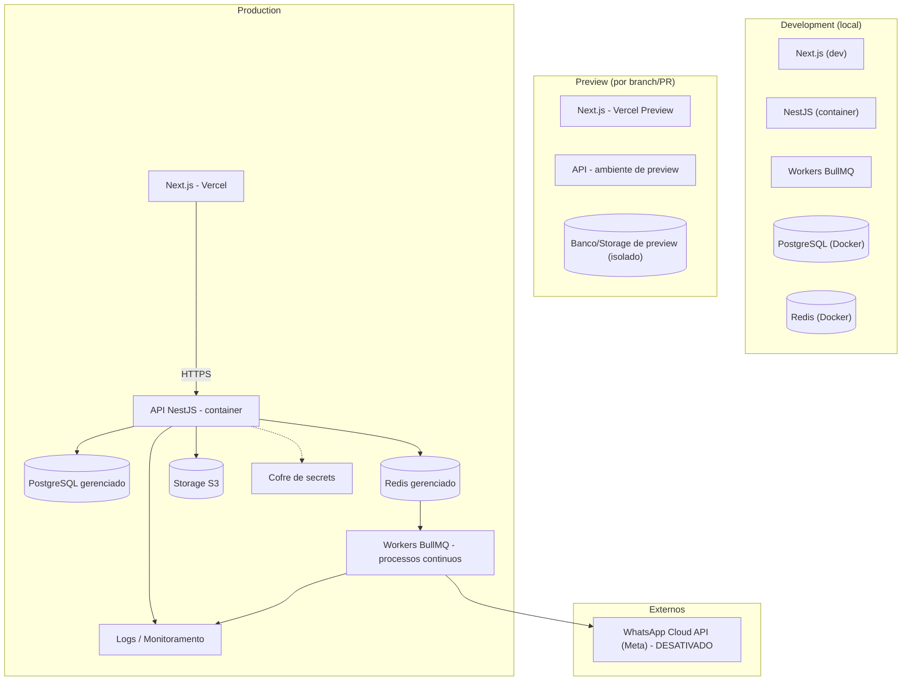
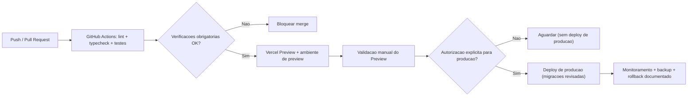

# Deploy e Infraestrutura

**Versão:** 1.0
**Data:** 21/11/2026
**Status:** Planejado (não implementado)

---

## 1. Objetivo

Definir a estratégia de deploy e infraestrutura do QUALITY TEST, fiel à **seção 13** da especificação mestra: Vercel para o frontend, API NestJS em container, workers BullMQ persistentes, serviços gerenciados externos e CI/CD via GitHub Actions.

> Conteúdo **Planejado**. Nenhum deploy foi realizado. Nenhuma credencial está definida.

---

## 2. Princípio de hospedagem

O repositório oficial será conectado à Vercel para implantação do frontend Next.js e de componentes compatíveis com o modelo de execução da plataforma.

**Não presumir que todos os serviços devem ou podem rodar na Vercel.** Em especial, a API e os workers exigem validação de compatibilidade antes de qualquer decisão.

---

## 3. Alocação de componentes (seção 13)

| Componente | Onde executa | Observação |
|---|---|---|
| Frontend Next.js | **Vercel** | Deploy do app web |
| Backend NestJS | Serviço/container apropriado | Avaliar serverless só após validar compatibilidade |
| Workers BullMQ | Infraestrutura com **processos contínuos** | Não depende do modelo serverless da Vercel |
| Redis | **Serviço gerenciado externo** | Fila e cache |
| PostgreSQL | **Serviço gerenciado externo** | Banco principal |
| Screenshots e anexos | **Storage S3-compatível** | URLs assinadas |
| Domínio e HTTPS | Configurar quando o domínio for fornecido | PENDENTE DE DEFINIÇÃO |
| Segredos | Variáveis de ambiente + cofre de secrets da plataforma | Nunca em código |
| Logs e monitoramento | Solução adequada para frontend, API e workers | PENDENTE DE DEFINIÇÃO |

---

## 4. Ambientes (seção 13.1)

### 4.1 Development

- Ambiente local.
- Dados de desenvolvimento.
- Serviços isolados (Docker Compose para PostgreSQL e Redis, conforme ETAPA 2).

### 4.2 Preview

- Deploys de validação associados a branches e pull requests.
- **Não utilizar credenciais de produção.**
- Banco/storage de preview **isolados** ou com segregação rigorosa.

### 4.3 Production

- Deploy controlado.
- Migrações revisadas.
- Backups.
- Monitoramento.
- Rollback documentado.
- Segredos próprios de produção.

---

## 5. Diagrama de deployment



---

## 6. CI/CD (seção 13.2)

Repositório: `https://github.com/alexsandrosodre/qualitytest.git`

Instruções previstas:

- Inspecionar o repositório existente.
- Configurar a branch principal conforme o **estado real do GitHub** (atualmente `main`, repositório vazio).
- Criar branches de feature e correção (nomes a definir — **PENDENTE DE DEFINIÇÃO**).
- Trabalhar por pull requests quando possível.
- Executar **lint, typecheck e testes** no CI.
- **Bloquear merge** quando verificações obrigatórias falharem.
- Integrar Vercel ao repositório.
- **Validar Preview** antes de produção.
- **Não executar deploy de produção sem autorização explícita.**

### 6.1 Pipeline proposto



### 6.2 Estágios do CI propostos

| Estágio | Conteúdo | Bloqueante? |
|---|---|---|
| Lint | ESLint/format | Sim |
| Typecheck | `tsc --noEmit` (TypeScript strict) | Sim |
| Testes unitários | Vitest/Jest | Sim |
| Testes de integração/API | Supertest | Sim |
| Testes E2E | Playwright | Sim (quando estável) |
| Build | Build de web/api/worker/extension | Sim |

---

## 7. Segredos e configuração

- Segredos via variáveis de ambiente e cofre de secrets da plataforma.
- **Nunca** em código, logs ou no frontend.
- Ambientes com segredos próprios (dev/preview/prod).
- A definição da lista final de variáveis é **PENDENTE DE DEFINIÇÃO** (depende de domínio, provedores e credenciais).

---

## 8. Logs, monitoramento e operação

- Solução adequada para frontend, API e workers.
- Logs sem credenciais ou dados sensíveis desnecessários.
- Backups e **restauração testada** (seção 14).
- Rollback documentado.

> Provedor de observabilidade — **PENDENTE DE DEFINIÇÃO**.

### 8.1 Backup e restauração (runbook)

Procedimento previsto para o PostgreSQL (a execução depende do provedor gerenciado — **PENDENTE DE DEFINIÇÃO**).

**Backup lógico (pg_dump):**

```bash
pg_dump --format=custom --no-owner --file=qualitytest-$(date +%Y%m%d).dump "$DATABASE_URL"
```

- Frequência: conforme RPO definido pela operação (a definir).
- Retenção: conforme política de retenção (**PENDENTE DE DEFINIÇÃO**).
- Armazenamento: cofre/objeto separado do ambiente de produção, com acesso restrito.

**Restauração (teste periódico em ambiente isolado):**

```bash
createdb qualitytest_restore
pg_restore --clean --no-owner --dbname=qualitytest_restore qualitytest-YYYYMMDD.dump
```

**Verificação pós-restauração:** aplicar migrações pendentes (`prisma migrate deploy`) e conferir a integridade de tabelas-chave (`users`, `projects`, `occurrences`, `audit_logs`). Registrar data, responsável e resultado do teste.

> O **teste de restauração** deve ser executado em ambiente isolado (nunca sobrescrevendo produção) e registrado. Status atual: procedimento documentado; execução **PENDENTE** (aguarda o provedor gerenciado).

---

## 9. Checklist de deploy (proposto)

- [ ] Migrações revisadas.
- [ ] Testes de CI verdes.
- [ ] Preview validado.
- [ ] Segredos de produção configurados.
- [ ] Backup realizado.
- [ ] Plano de rollback documentado.
- [ ] Autorização explícita para produção.
- [ ] Monitoramento ativo após o deploy.

---

## 10. Pontos pendentes de definição

- Domínio oficial e HTTPS — **PENDENTE DE DEFINIÇÃO**.
- Conta/projeto na Vercel e credenciais — **PENDENTE DE DEFINIÇÃO**.
- Provedor de PostgreSQL gerenciado — **PENDENTE DE DEFINIÇÃO**.
- Provedor de Redis gerenciado — **PENDENTE DE DEFINIÇÃO**.
- Provedor de storage S3-compatível — **PENDENTE DE DEFINIÇÃO**.
- Solução de logs/monitoramento — **PENDENTE DE DEFINIÇÃO**.
- Nomes de branches — **PENDENTE DE DEFINIÇÃO**.
- Capacidade/plano dos serviços gerenciados — **PENDENTE DE DEFINIÇÃO**.

---

## 11. Referências

- Especificação mestra, seções 12, 13, 14.
- [arquitetura-geral.md](arquitetura-geral.md)
- [c4.md](c4.md)
- [riscos-e-dependencias.md](riscos-e-dependencias.md)
