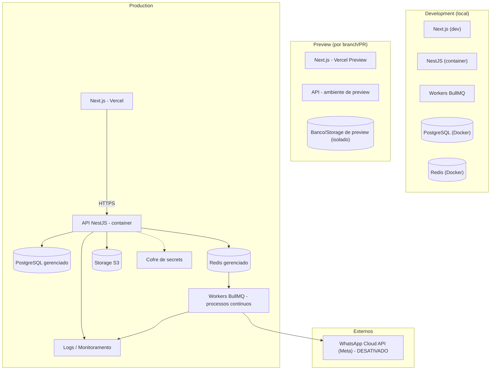
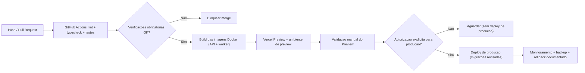

# Deploy e Infraestrutura

**Versão:** 1.2
**Data:** 21/11/2026
**Status:** Preparação implementada — deploy **não executado** (nenhum ambiente de produção provisionado)

---

## 1. Objetivo

Definir a estratégia de deploy e infraestrutura do QUALITY TEST, fiel à **seção 13** da especificação mestra: Vercel para o frontend, API NestJS em container, workers BullMQ persistentes, serviços gerenciados externos e CI/CD via GitHub Actions.

> Os artefatos de build já estão versionados (Dockerfiles, `.dockerignore`, scripts e job de CI). **Nenhum deploy foi realizado e nenhuma credencial está definida.** O que depende de decisão externa permanece **PENDENTE DE DEFINIÇÃO**.

---

## 2. Princípio de hospedagem

O repositório oficial será conectado à Vercel para implantação do frontend Next.js e de componentes compatíveis com o modelo de execução da plataforma.

**Não presumir que todos os serviços devem ou podem rodar na Vercel.** Em especial, a API e os workers exigem validação de compatibilidade antes de qualquer decisão.

---

## 3. Alocação de componentes (seção 13)

| Componente | Onde executa | Artefato no repositório |
|---|---|---|
| Frontend Next.js | **Vercel** | `apps/web` (configuração na plataforma — ver §7) |
| Backend NestJS | Serviço/container apropriado | [docker/api.Dockerfile](../../docker/api.Dockerfile) |
| Workers BullMQ | Infraestrutura com **processos contínuos** | [docker/worker.Dockerfile](../../docker/worker.Dockerfile) |
| Redis | **Serviço gerenciado externo** | Consumido via `REDIS_*` |
| PostgreSQL | **Serviço gerenciado externo** | Consumido via `DATABASE_URL` |
| Screenshots e anexos | **Storage S3-compatível** | Consumido via `S3_*` (URLs assinadas) |
| Domínio e HTTPS | Configurar quando o domínio for fornecido | PENDENTE DE DEFINIÇÃO |
| Segredos | Variáveis de ambiente + cofre de secrets da plataforma | Nunca em código (ver §7) |
| Logs e monitoramento | Solução adequada para frontend, API e workers | PENDENTE DE DEFINIÇÃO |

### 3.1 Artefatos de deploy versionados

| Artefato | Descrição |
|---|---|
| `.dockerignore` | Reduz o contexto Docker e evita copiar segredos (`node_modules`, `dist`, `.next`, `docs`, `.env`, etc.) |
| `docker/api.Dockerfile` | Build multi-stage da API (NestJS `apps/api/dist/main.js`) + `HEALTHCHECK` em `/api/health` |
| `docker/worker.Dockerfile` | Build multi-stage do worker (`apps/worker/dist/index.js`) |
| `.env.production.example` | Modelo documentado das variáveis de produção (sem segredos reais) |
| `scripts/smoke-test.mjs` | Smoke test pós-deploy de `/api/health` (usado via `npm run smoke:test`) |
| Scripts npm | `docker:build:api`, `docker:build:worker`, `docker:build`, `smoke:test` (raiz) |
| Job de CI | `docker-images` em [.github/workflows/ci.yml](../../.github/workflows/ci.yml) — valida o build das imagens a cada push/PR |
| Workflow de release | [.github/workflows/release.yml](../../.github/workflows/release.yml) — publica as imagens no GHCR e aplica migrações sob aprovação (§6.3) |

**Build e execução local de validação:**

```bash
# Build (contexto = raiz do monorepo)
npm run docker:build:api      # docker build -f docker/api.Dockerfile -t qualitytest-api .
npm run docker:build:worker   # docker build -f docker/worker.Dockerfile -t qualitytest-worker .

# Execução (variáveis vêm do ambiente/cofre — nunca embutidas na imagem)
docker run --rm -p 3333:3333 --env-file .env.production qualitytest-api
docker run --rm --env-file .env.production qualitytest-worker
```

> As imagens **não** executam migrações no boot: a aplicação das migrações é um passo controlado e separado (§8.2).

---

## 4. Ambientes (seção 13.1)

### 4.1 Development

- Ambiente local.
- Dados de desenvolvimento.
- Serviços isolados (Docker Compose para PostgreSQL e Redis, conforme ETAPA 2).

### 4.2 Preview

- Deploys de validação associados a branches e pull requests.
- **Não utilizar credenciais de produção.**
- Banco/storage de preview **isolados** ou com segregação rigorosa.

### 4.3 Production

- Deploy controlado.
- Migrações revisadas.
- Backups.
- Monitoramento.
- Rollback documentado.
- Segredos próprios de produção.

---

## 5. Diagrama de deployment



---

## 6. CI/CD (seção 13.2)

Repositório: `https://github.com/alexsandrosodre/qualitytest.git`

Instruções previstas:

- Inspecionar o repositório existente.
- Configurar a branch principal conforme o **estado real do GitHub** (atualmente `main`).
- Criar branches de feature e correção (nomes a definir — **PENDENTE DE DEFINIÇÃO**).
- Trabalhar por pull requests quando possível.
- Executar **lint, typecheck e testes** no CI.
- **Bloquear merge** quando verificações obrigatórias falharem.
- Integrar Vercel ao repositório.
- **Validar Preview** antes de produção.
- **Não executar deploy de produção sem autorização explícita.**

### 6.1 Pipeline proposto



### 6.2 Estágios do CI

Implementado em [.github/workflows/ci.yml](../../.github/workflows/ci.yml):

| Job | Estágio | Conteúdo | Bloqueante? |
|---|---|---|---|
| `quality` | Lint | ESLint | Sim |
| `quality` | Typecheck | `tsc --noEmit` (TypeScript strict) | Sim |
| `quality` | Testes | Jest (unitários + e2e da API, worker) | Sim |
| `quality` | Build | Build de shared/api/worker/web/extension | Sim |
| `docker-images` | Imagens | `docker build` da API e do worker (sem publicar) | Sim (depende de `quality`) |

> O job `docker-images` roda apenas após `quality` passar e **não publica** imagens — a publicação é feita pelo workflow de release (§6.3), que usa o `GITHUB_TOKEN` e não exige credenciais externas.

### 6.3 Publicação de imagens e migrações (release)

Implementado em [.github/workflows/release.yml](../../.github/workflows/release.yml), executado **manualmente** (Actions → Release → Run workflow) ou por push de tag `v*`:

| Job | Conteúdo | Gate |
|---|---|---|
| `publish-images` | `docker build` + `push` das imagens da API e do worker no **GHCR** (`ghcr.io/<owner>/qualitytest`, repositório e pacotes do próprio GitHub) com a tag informada e uma tag imutável `sha-<40>` | `GITHUB_TOKEN` (`packages: write`) |
| `migrate` | `npm run db:migrate:deploy` contra o banco alvo | Só roda com `run_migrations=true` e no environment **`production`** — configure **revisores obrigatórios** nesse environment para tornar a aprovação manual efetiva |

Ordem recomendada em uma release: (1) CI verde; (2) `publish-images`; (3) `migrate` (se houver migração); (4) publicar a nova versão nos serviços; (5) `npm run smoke:test`.

> O GHCR é o registro padrão por ser do próprio provedor do repositório e não exigir credenciais adicionais. Se houver exigência corporativa por outro registro, o workflow deve ser ajustado (**PENDENTE DE DEFINIÇÃO**).

---

## 7. Segredos e configuração

- Segredos via variáveis de ambiente e cofre de secrets da plataforma.
- **Nunca** em código, logs ou no frontend.
- Ambientes com segredos próprios (dev/preview/prod).
- `.env.example` documenta o conjunto completo com valores de **desenvolvimento**; `.env.production.example` é o **modelo de produção** (todos os campos a definir, sem segredos reais).

### 7.1 Variáveis de produção (referência)

| Variável | Consumidor | Observação |
|---|---|---|
| `NODE_ENV` | API | `production` |
| `API_PORT` | API | Porta interna do container (padrão `3333`) |
| `CORS_ORIGIN` | API | Whitelist (CSV) das origens do frontend — **sem wildcard** |
| `JWT_SECRET` | API | **≥ 32 caracteres**, exclusivo; a API recusa o valor de exemplo em produção (ETAPA 10) |
| `JWT_ACCESS_TTL` / `JWT_REFRESH_TTL` | API | TTLs de access/refresh token |
| `THROTTLE_TTL` / `THROTTLE_LIMIT` | API | Rate limiting global |
| `DATABASE_URL` | API, worker | PostgreSQL gerenciado |
| `REDIS_HOST` / `REDIS_PORT` / `REDIS_DB` / `REDIS_PASSWORD` | API, worker | Redis gerenciado (fila BullMQ) |
| `NOTIFICATIONS_ENABLED` / `NOTIFICATIONS_CONCURRENCY` | API, worker | Fila de notificações |
| `WEB_BASE_URL` | API, worker | URL pública do frontend (links nas mensagens) |
| `AI_ENABLED` / `AI_PROVIDER` | API | IA opcional (padrão desativada) |
| `S3_ENDPOINT` / `S3_REGION` / `S3_BUCKET` / `S3_ACCESS_KEY` / `S3_SECRET_KEY` | API | Storage de anexos (URLs assinadas) |
| `NEXT_PUBLIC_API_URL` | Frontend (Vercel) | URL pública da API (`https://<api>/api`) — **embutida no build** do Next.js |
| `SEED_ADMIN_PASSWORD` / `SEED_ADMIN_EMAIL` | Seed | **Somente** para o seed; não é variável de runtime da API |

> A lista definitiva de valores depende de domínio, provedores e credenciais — **PENDENTE DE DEFINIÇÃO**.

### 7.2 Configuração do frontend na Vercel

- Importar o repositório e definir o **Root Directory** como `apps/web`.
- Framework preset **Next.js** (detectado automaticamente).
- Definir `NEXT_PUBLIC_API_URL` nas variáveis de ambiente do projeto (Preview e Production, com valores distintos).
- O backend (API/worker) **não** roda na Vercel — apenas o frontend.
- O domínio oficial e a conta/projeto na Vercel são **PENDENTES DE DEFINIÇÃO**.

---

## 8. Logs, monitoramento e operação

- Solução adequada para frontend, API e workers.
- Logs sem credenciais ou dados sensíveis desnecessários (a API e o worker registram em `stdout`/`stderr`).
- Backups e **restauração testada** (seção 14).
- Rollback documentado.

> Provedor de observabilidade — **PENDENTE DE DEFINIÇÃO**.

### 8.1 Backup e restauração (runbook)

Procedimento previsto para o PostgreSQL (a execução depende do provedor gerenciado — **PENDENTE DE DEFINIÇÃO**).

**Backup lógico (pg_dump):**

```bash
pg_dump --format=custom --no-owner --file=qualitytest-$(date +%Y%m%d).dump "$DATABASE_URL"
```

- Frequência: conforme RPO definido pela operação (a definir).
- Retenção: conforme política de retenção (**PENDENTE DE DEFINIÇÃO**).
- Armazenamento: cofre/objeto separado do ambiente de produção, com acesso restrito.

**Restauração (teste periódico em ambiente isolado):**

```bash
createdb qualitytest_restore
pg_restore --clean --no-owner --dbname=qualitytest_restore qualitytest-YYYYMMDD.dump
```

**Verificação pós-restauração:** aplicar migrações pendentes (`prisma migrate deploy`) e conferir a integridade de tabelas-chave (`users`, `projects`, `occurrences`, `audit_logs`). Registrar data, responsável e resultado do teste.

> O **teste de restauração** deve ser executado em ambiente isolado (nunca sobrescrevendo produção) e registrado. Status atual: procedimento documentado; execução **PENDENTE** (aguarda o provedor gerenciado).

### 8.2 Migrações de banco (runbook)

As migrações Prisma são aplicadas de forma controlada, **fora do boot** da aplicação:

```bash
# A partir da raiz do monorepo, com DATABASE_URL apontando para o banco alvo
npm run db:migrate:deploy
```

- Revisar a migração (`apps/api/prisma/migrations/`) e o plano de rollback antes de aplicar.
- **Nunca** usar `prisma migrate dev` em produção (pode resetar dados).
- Aplicar antes de publicar a nova versão da API que depende do schema.
- Registrar a versão aplicada e o responsável.

### 8.3 Rollback (runbook)

- **Aplicação:** publicar novamente a imagem/versão anterior (tag imutável por release).
- **Banco:** migrações do Prisma são **somente avanço**; o rollback típico é aplicar uma **nova migração** que desfaça a mudança (expand/contract), nunca editar migração já aplicada.
- **Configuração:** reverter variáveis de ambiente/segredos para os valores anteriores.
- **Validação pós-rollback:** `/api/health` respondendo e verificação das tabelas-chave.
- Registrar incidente, causa e horários.

### 8.4 Smoke test pós-deploy

Validação objetiva de que a nova versão subiu e que o banco responde:

```bash
# API_BASE_URL aponta para o ambiente publicado (padrão: http://localhost:3333/api)
$env:API_BASE_URL = "https://<definir-host-da-api>/api"
npm run smoke:test
```

- Consulta `GET /health` (rota pública), com tentativas e intervalo configuráveis (`SMOKE_RETRIES`, `SMOKE_DELAY_MS`).
- Falha (exit code ≠ 0) se a API não responder ou se `status != "ok"` — adequado para uso em CI/CD e após rollback.
- A imagem da API também declara um `HEALTHCHECK` sobre a mesma rota.

---

## 9. Checklist de deploy

- [ ] Migrações revisadas.
- [x] Testes de CI verdes (lint, typecheck, testes e build).
- [x] Build das imagens Docker validado no CI.
- [ ] Preview validado.
- [ ] Segredos de produção configurados.
- [ ] Domínio/HTTPS configurados.
- [ ] Backup realizado.
- [x] Plano de rollback documentado (procedimento definido em §8.3).
- [ ] Autorização explícita para produção.
- [ ] Monitoramento ativo após o deploy.
- [ ] Smoke test pós-deploy executado com sucesso (§8.4).

---

## 10. Pontos pendentes de definição

- Domínio oficial e HTTPS — **PENDENTE DE DEFINIÇÃO**.
- Conta/projeto na Vercel e credenciais — **PENDENTE DE DEFINIÇÃO**.
- Provedor de PostgreSQL gerenciado — **PENDENTE DE DEFINIÇÃO**.
- Provedor de Redis gerenciado — **PENDENTE DE DEFINIÇÃO**.
- Provedor de storage S3-compatível — **PENDENTE DE DEFINIÇÃO**.
- Registry de imagens: **GHCR por padrão** (workflow `release.yml`, via `GITHUB_TOKEN`); trocar apenas se houver exigência corporativa por outro registro.
- Solução de logs/monitoramento — **PENDENTE DE DEFINIÇÃO**.
- Nomes de branches de feature/correção — **PENDENTE DE DEFINIÇÃO**.
- Capacidade/plano dos serviços gerenciados — **PENDENTE DE DEFINIÇÃO**.

---

## 11. Referências

- Especificação mestra, seções 12, 13, 14.
- [arquitetura-geral.md](arquitetura-geral.md)
- [c4.md](c4.md)
- [seguranca-lgpd.md](seguranca-lgpd.md)
- [riscos-e-dependencias.md](riscos-e-dependencias.md)
