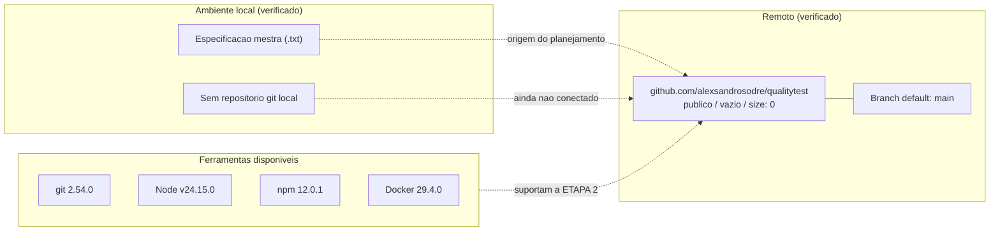

# Diagnóstico do Repositório e do Ambiente

**Versão:** 1.0
**Data:** 21/11/2026
**Status:** Planejado (não implementado)

---

## 1. Objetivo

Registrar o estado real e verificado do repositório e do ambiente de desenvolvimento do QUALITY TEST, conforme exigido pela **ETAPA 1 — DIAGNÓSTICO E ARQUITETURA** do plano de execução (seção 19 da especificação mestra) e pela seção 21 ("Prompt de Primeira Execução").

Este diagnóstico é a base factual para todas as decisões arquiteturais dos demais documentos. Nenhum item abaixo foi obtido por suposição: reflete apenas o estado verificado.

---

## 2. Tabela de estado verificado

| Item verificado | Resultado observado | Situação |
|---|---|---|
| Workspace local `c:\Users\acsodre\Desktop\qualitytest` | Contém apenas o arquivo de especificação `Quality_Test_Especificacao_Mestre_GitHub_Vercel_v4.txt` | Sem código |
| Repositório local é git? | **Não** — não é um repositório git inicializado | Sem versionamento local |
| Repositório remoto `https://github.com/alexsandrosodre/qualitytest.git` | Existe, é **público** e está **VAZIO** (sem commits, `size: 0`) | Vazio |
| Branch default do remoto | `main` | Definido pelo GitHub |
| Data de criação do remoto | 2026-11-20 | Observado |
| Código de aplicação implementado | Nenhum | Nada implementado |
| Git local | 2.54.0 | Disponível |
| Node.js | v24.15.0 | Disponível |
| npm | 12.0.1 | Disponível |
| Docker | 29.4.0 | Disponível |

---

## 3. Interpretação do estado

### 3.1 Repositório remoto vazio

O repositório oficial existe e está acessível publicamente, porém sem nenhum commit. Isso implica que:

- Não há trabalho prévio a preservar (a especificação exige preservar implementações e configurações úteis — não há nenhuma).
- Não existe histórico de branches a analisar além da branch default `main`.
- A "configuração de branch principal" citada na seção 13.2 será, na prática, a definição da estrutura inicial sobre `main`.

> A especificação (seção 13.2) orienta **não presumir nomes de branches**. Portanto, qualquer branch de trabalho/feature a ser criada será definida no momento da implementação e **não é documentada aqui como fato**.

### 3.2 Ambiente local com apenas a especificação

O workspace contém somente o documento mestre. Isso implica que:

- A **ETAPA 2 — FUNDAÇÃO** (monorepositório, TypeScript strict, lint/format, Docker Compose, PostgreSQL e Redis, CI inicial) ainda não foi iniciada.
- Nenhuma dependência foi instalada, nenhum `package.json` existe, nenhum lockfile existe.
- As ferramentas necessárias (git, Node, npm, Docker) estão presentes na máquina, o que permite iniciar a fundação quando autorizado.

### 3.3 Ausência de repositório git local

O diretório de trabalho não é um repositório git. Isso implica que:

- Não há remoto configurado localmente; a conexão com `https://github.com/alexsandrosodre/qualitytest.git` ainda precisa ser estabelecida.
- Nenhuma operação de commit/push pode ser presumida.

---

## 4. Conclusão

| Pergunta | Resposta |
|---|---|
| Há código implementado? | Não |
| Há trabalho a preservar? | Não (apenas a especificação) |
| O repositório remoto está pronto para receber a fundação? | Sim, está vazio |
| O ambiente local suporta iniciar a fundação? | Sim (git, Node, npm e Docker disponíveis) |
| Em qual etapa estamos? | **ETAPA 1 — Diagnóstico e Arquitetura (em andamento)** |

O estado atual é o **ponto de partida zero**: um repositório vazio, um ambiente preparado e uma especificação completa. Não há risco de sobrescrever trabalho existente, e o caminho natural é produzir primeiro a documentação de arquitetura (esta entrega) e, em seguida, iniciar a fundação em uma branch de trabalho.

---

## 5. Implicações para as próximas etapas

1. **Documentação primeiro.** A ETAPA 1 prevê diagnóstico, arquitetura, ER, RBAC, isolamento, contratos, riscos/custos, estratégia Vercel e ADRs iniciais. Esta entrega cobre esses artefatos.
2. **Fundação em branch de trabalho.** A especificação (seção 21) determina implementar a fundação "em uma branch de trabalho, preservando o conteúdo existente". O nome da branch será definido na execução — **PENDENTE DE DEFINIÇÃO**.
3. **Sem deploy de produção.** Nenhuma ação de deploy deve ocorrer sem autorização explícita (seções 13.2 e 21).
4. **Integrações externas.** WhatsApp, storage, Postgres, Redis, domínio e Vercel dependem de definição externa (ver [riscos-e-dependencias.md](riscos-e-dependencias.md)).

---

## 6. Diagrama do estado atual

---

## 7. Referências

- Especificação mestra, seções 0, 13.2, 19 (ETAPA 1) e 21.
- [arquitetura-geral.md](arquitetura-geral.md)
- [plano-incremental.md](plano-incremental.md)
- [riscos-e-dependencias.md](riscos-e-dependencias.md)
