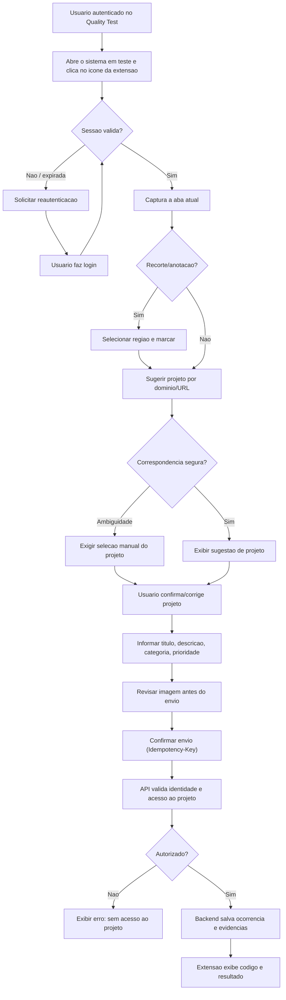

# Estratégia da Extensão Chrome

**Versão:** 1.0
**Data:** 21/11/2026
**Status:** Planejado (não implementado)

---

## 1. Objetivo

Definir a estratégia da extensão do Google Chrome do QUALITY TEST, que permite ao testador registrar uma ocorrência enquanto navega no sistema testado, sem alternar para o painel principal. Fiel à **seção 6** da especificação mestra.

> Conteúdo **Planejado**. Representa a arquitetura alvo. Nada foi implementado.

---

## 2. Tecnologia

- **Chrome Extension Manifest V3.**
- **TypeScript.**
- Interface **React** (ou tecnologia compatível com a arquitetura).
- Consome a **mesma API REST** do painel principal, usando a sessão autenticada do Quality Test.

---

## 3. Fluxo principal (seção 6.1)

1. Usuário autentica-se no Quality Test.
2. Abre o sistema que está testando.
3. Clica no ícone da extensão.
4. A extensão permite capturar a aba atual.
5. Opcionalmente, permite selecionar uma região da tela e fazer marcações.
6. Usuário seleciona ou confirma o projeto.
7. Informa título, descrição, categoria e prioridade.
8. Confirma o envio.
9. A API valida identidade e acesso ao projeto.
10. O backend salva ocorrência e evidências.
11. A extensão apresenta o código da ocorrência e o resultado do envio.

---

## 4. Diagrama de fluxo



---

## 5. Identificação do projeto por domínio (seção 6.2)

- Permitir **seleção manual** do projeto.
- Permitir **configurar associação de domínio/URL a projeto** (via `ProjectDomainMapping`).
- Se houver correspondência segura, **sugerir o projeto** — usando `GET /projects/suggest?url=<url>`.
- **Exibir claramente a sugestão.**
- Permitir **correção manual**.
- Se houver **ambiguidade**, exigir seleção.
- **Validar no backend** se o usuário participa do projeto.

> A sugestão **nunca** seleciona um projeto silenciosamente. A spec é explícita: "Não selecionar silenciosamente um projeto incorreto" (seção 2.4). O `projectId` é tratado como intenção e validado no servidor.

---

## 6. Dados técnicos coletados x proibidos (seção 6.3)

### 6.1 Coletados (apenas necessários e permitidos)

| Dado | Observação |
|---|---|
| URL e título da página | Sempre |
| Data e hora | Registradas pelo servidor |
| Dimensões da captura | Quando disponível |
| Resolução/viewport | Quando disponível |
| Navegador e versão | Quando disponível |
| Sistema operacional | Somente quando disponível de forma confiável |

### 6.2 Proibidos

- Senhas.
- Cookies.
- Tokens.
- Dados de autenticação do sistema testado.
- Conteúdo de formulários.
- Dados pessoais ou sensíveis da página sem necessidade e autorização.

> **Aviso de privacidade:** a captura de tela pode conter dados sensíveis visíveis. Exibir orientação ao usuário para **revisar a imagem antes do envio** e avaliar recurso de recorte/ocultação antes de anexar.

---

## 7. Segurança da extensão (seção 6.4)

- Usar **APIs oficiais** do navegador.
- Solicitar **somente permissões necessárias**.
- **Não injetar scripts** sem necessidade.
- **Não armazenar tokens** em local inseguro.
- Proteger a comunicação com a API via **HTTPS**.
- Implementar **expiração e renovação segura de sessão**.
- **Restringir domínios e permissões** no manifest.
- **Não expor credenciais** no código da extensão.
- **Documentar instalação e atualização.**

`host_permissions` e demais permissões do Manifest V3 serão definidas na implementação, restritas ao domínio da API — **PENDENTE DE DEFINIÇÃO** (depende do domínio oficial).

---

## 8. Falhas de conexão e idempotência (seção 6.5)

- Pode haver **fila local temporária de envio**, com proteção de dados e expiração.
- Reenvios devem usar **chave de idempotência** para evitar ocorrências duplicadas.
- Informar claramente ao usuário quando a ocorrência estiver **pendente, enviada ou falhou**.

---

## 9. Diagrama de sequência — registro de ocorrência pela extensão

```mermaid
sequenceDiagram
    autonumber
    participant U as Testador
    participant EX as Extensao (MV3)
    participant API as API NestJS
    participant DB as PostgreSQL
    participant S3 as Storage S3

    U->>EX: Abre extensao na aba do sistema testado
    EX->>EX: Le URL/titulo e captura screenshot
    EX->>API: GET /projects/suggest?url=<url>
    API-->>EX: Sugestoes (confirmaveis) / ambiguous
    EX-->>U: Exibe sugestao de projeto
    U->>EX: Confirma/corrige projeto e preenche dados
    U->>EX: Revisa imagem e confirma envio
    EX->>API: POST /occurrences (Idempotency-Key)
    API->>API: Valida sessao e ProjectMember(userId, projectId)
    alt Sem acesso ao projeto
        API-->>EX: 403 Forbidden
        EX-->>U: Exibe erro (sem acesso)
    else Autorizado
        API->>S3: Gera URL assinada de upload
        EX->>S3: Envia imagem
        API->>DB: Persiste ocorrencia + anexo + historico + auditoria
        API-->>EX: 201 Created (publicCode)
        EX-->>U: Exibe codigo e resultado
    end
    Note over EX,API: Se offline: fila local com expiracao; reenvio usa a mesma Idempotency-Key
```

---

## 10. Estados de sessão e envio

| Situação | Comportamento planejado |
|---|---|
| Sessão válida | Prossegue com captura e envio |
| Sessão expirada | Solicitar reautenticação antes do envio |
| Sem conexão | Fila local temporária; avisar "pendente" |
| Reenvio | Usa a mesma `Idempotency-Key` (evita duplicidade) |
| Falha de autorização | Erro claro de "sem acesso ao projeto" |
| Sucesso | Exibir `publicCode` e confirmação |

---

## 11. Pontos pendentes de definição

- Domínio oficial da API/extensão — **PENDENTE DE DEFINIÇÃO**.
- Lista exata de `permissions`/`host_permissions` do Manifest V3 — derivada do domínio — **PENDENTE DE DEFINIÇÃO**.
- Mecanismo de armazenamento seguro do token na extensão — **PENDENTE DE DEFINIÇÃO**.
- Canal de distribuição da extensão (Chrome Web Store interna vs. carregamento local) — **PENDENTE DE DEFINIÇÃO**.

---

## 12. Referências

- Especificação mestra, seções 2.4, 3.3, 6, 12.
- [contratos-api.md](contratos-api.md)
- [permissoes-e-isolamento.md](permissoes-e-isolamento.md)
