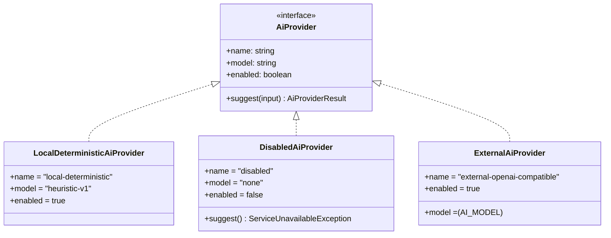
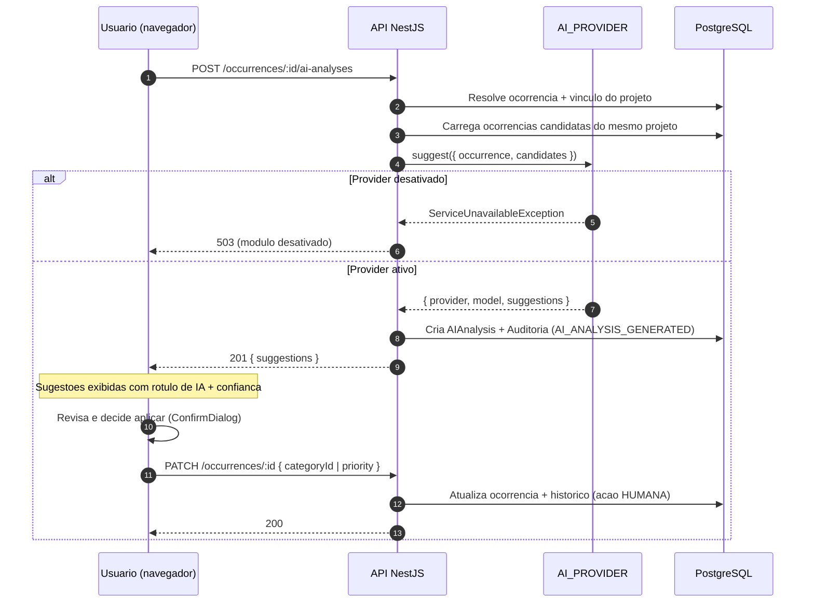

# IA Opcional

**Versão:** 1.0
**Data:** 21/11/2026
**Status:** Implementado (módulo desativado por padrão; provedor externo plugável via `AI_PROVIDER=external`)

---

## 1. Objetivo

Descrever o módulo **opcional** de IA do QUALITY TEST, fiel à **seção 8** da especificação mestra: sugestões assistivas de classificação, prioridade, resumo e detecção de duplicidade. O módulo é **desativável**, **não bloqueante** e **nunca** altera uma ocorrência sem confirmação humana.

> **Estado atual: DESATIVADO por padrão** (`AI_ENABLED=false`). Implementado na **Etapa 9** (ver seção 11).

---

## 2. Princípios invioláveis (seção 8)

1. **Assistiva, não autônoma.** A IA apenas **sugere**; toda aplicação de sugestão (categoria/prioridade) exige **ação humana** explícita e confirmação.
2. **Desativável.** Sem `AI_ENABLED=true`, nenhuma sugestão é gerada e a geração responde **`503`**. O restante do sistema permanece íntegro.
3. **Desacoplada.** A IA não faz parte do caminho crítico: indisponibilidade do módulo **não** impede cadastro, consulta ou alteração de ocorrências.
4. **Sem segredos persistidos.** Registra-se apenas `provider` e `model`; **nunca** tokens, chaves ou credenciais.
5. **Privacidade por padrão.** O provedor recebe apenas dados **não sensíveis** (título, descrição, classificação, e — para duplicidade — título/código de ocorrências candidatas **do mesmo projeto**). Nunca anexos/screenshots.
6. **Isolamento por projeto.** Listagem e geração validam o vínculo ativo do usuário com o projeto da ocorrência (mesma fonte única de autorização: `ProjectAccessService`).

---

## 3. Arquitetura do módulo

O provider fica atrás de um **token de injeção** (`AI_PROVIDER`), permitindo trocar a implementação sem alterar serviço/controller.

> A implementação ativa é escolhida em runtime por `AI_ENABLED` + `AI_PROVIDER`: `local` (padrão, determinístico e sem rede) ou `external` (adaptador compatível com OpenAI, exige credenciais). Sem credenciais, `external` recai em `DisabledAiProvider`.

- `AiAnalysesService` resolve o acesso, monta o insumo (campos não sensíveis), chama o provider, persiste a análise (`AIAnalysis`) e registra auditoria (`AI_ANALYSIS_GENERATED`).
- `AiAnalysesController` expõe `GET`/`POST /occurrences/:occurrenceId/ai-analyses` (sem `:projectId` — a autorização é resolvida no serviço a partir da ocorrência).
- `AiModule` cria o provider via factory que lê `AI_ENABLED`/`AI_PROVIDER` do `ConfigService`.

---

## 4. Provedor local determinístico

Implementação padrão (`AI_ENABLED=true` + `AI_PROVIDER=local`), **sem rede e sem credenciais**:

| Sugestão | Heurística |
|---|---|
| `RESUMO` | Descrição normalizada (ou título, quando vazia), limitada a 240 caracteres. |
| `CATEGORIA` | Palavras-chave sem acento por categoria (visual, integração, validação, desempenho, segurança, acessibilidade, compatibilidade); `ERRO_FUNCIONAL` é **fallback** quando apenas indícios genéricos de erro são encontrados. Não sugere quando coincide com a categoria atual. |
| `PRIORIDADE` | Palavras-chave por severidade (decrescente: crítica → alta → média → baixa); não sugere quando coincide com a prioridade atual. |
| `DUPLICIDADE` | Similaridade de **Jaccard** entre títulos do mesmo projeto (limiar 0.5, máximo de 3 candidatas; exclui a própria ocorrência). |

Cada sugestão carrega `confidence` (0–1) e `rationale` (motivo legível). O resultado é **determinístico** para a mesma entrada.

---

## 5. Configuração

| Variável | Valores | Efeito |
|---|---|---|
| `AI_ENABLED` | `true` / `false` (padrão `false`) | Habilita a geração de sugestões. |
| `AI_PROVIDER` | `local` (padrão) / `external` / outro | `local` usa o provedor determinístico; `external` usa o adaptador compatível com OpenAI; valores desconhecidos recaem em `DisabledAiProvider` com aviso. |
| `AI_BASE_URL` | URL | Obrigatório com `external`. URL base compatível com OpenAI, incluindo o prefixo de versão (ex.: `https://api.openai.com/v1`). |
| `AI_API_KEY` | segredo | Obrigatório com `external`. **Nunca** persistido nem registrado em log. |
| `AI_MODEL` | string | Obrigatório com `external`. Identificador do modelo a ser usado. |
| `AI_TIMEOUT_MS` | inteiro (padrão `20000`) | Tempo-limite da chamada HTTP do provedor externo. |

> O **provedor externo** (compatível com a API OpenAI `POST {baseUrl}/chat/completions`) está **implementado** e é plugável atrás do mesmo contrato `AiProvider`. Ele só é instanciado quando `AI_ENABLED=true` **e** `AI_PROVIDER=external` **e** as três credenciais (`AI_BASE_URL`, `AI_API_KEY`, `AI_MODEL`) estão presentes; caso contrário, o módulo permanece desativado. O adaptador envia apenas dados **não sensíveis** e exige resposta em JSON estrito (`response_format: json_object`), validando/normalizando as sugestões contra os domínios conhecidos.

---

## 6. Endpoints e autorização

| Método | Caminho | Descrição | Permissão |
|---|---|---|---|
| GET | `/occurrences/:occurrenceId/ai-analyses` | Lista as análises registradas | Membro ativo do projeto (ou ADMINISTRADOR) |
| POST | `/occurrences/:occurrenceId/ai-analyses` | Gera sugestões e registra a análise (auditoria) | Membro ativo do projeto (ou ADMINISTRADOR) |

Aplicar uma sugestão usa os endpoints de ocorrência já existentes: `PATCH /occurrences/:occurrenceId` com `categoryId` (permissão de edição) ou `priority` (permissão de alterar prioridade). Isso mantém o histórico e a auditoria do núcleo.

---

## 7. Fluxo de confirmação humana

---

## 8. Privacidade e limites de dados

- Insumo restrito a `id`, `publicCode`, `title`, `description`, `categoryId`, `priority` (ocorrência) e `id`, `publicCode`, `title`, `description` (candidatas) — **sem** autor, anexos ou dados de outros projetos.
- Nenhuma credencial é persistida; o provedor local não acessa a rede.
- Para conectar um provedor externo, é obrigatório avaliar configuração, base legal e controles antes de enviar qualquer dado fora do ambiente.

---

## 9. Testes

- **Unitários**
  - `src/ai/local-deterministic-ai.provider.spec.ts`, 11 casos: provider habilitado/nome/modelo; resumo e fallback; truncamento; categoria por palavra-chave e não-sugestão quando coincide; prioridade crítica e não-sugestão; duplicidade excluindo a própria; limite de 3; `DisabledAiProvider` (desabilitado + `503`).
  - `src/ai/external-ai.provider.spec.ts`, 7 casos: identificação/estado do adaptador; endpoint e cabeçalho `Bearer` (sem vazar a chave); normalização e filtragem de sugestões inválidas; tolerância a cercas Markdown e a JSON inválido; erro HTTP; erro de rede; resposta sem conteúdo.
- **E2E** (`test/ai.e2e-spec.ts`, 9 casos): `401` sem autenticação; membro lista com `enabled=true` e `items=[]`; outsider `403`; ocorrência inexistente `404`; geração `201` com sugestões e auditoria; listagem de análises; ocorrência de outro projeto `403`; módulo desativado `503` + `enabled=false`.

> Os testes do adaptador externo **mockam** `fetch` — nenhuma chamada de rede real é feita.

---

## 10. Pontos pendentes de definição

- Provedor externo (ex.: OpenAI-compatível) — **implementado** (adaptador plugável via `AI_PROVIDER=external`); a escolha do provedor concreto e o fornecimento das credenciais seguem **PENDENTE DE DEFINIÇÃO**.
- Base legal / política de privacidade para envio de dados a terceiros — **PENDENTE DE DEFINIÇÃO**.
- Limites de uso e custos do provedor externo — **PENDENTE DE DEFINIÇÃO**.

---

## 11. Estado da implementação (Etapa 9)

**Shared (`packages/shared`)**
- `AiSuggestionType` (`RESUMO`, `CATEGORIA`, `PRIORIDADE`, `DUPLICIDADE`) e `AI_SUGGESTION_TYPES`.
- DTOs `AiSuggestionDTO`, `AiAnalysisDTO` e `AiAnalysesResult`.

**API (`apps/api`)**
- `ai/ai-provider.ts`: token `AI_PROVIDER`, contrato `AiProvider`, `DisabledAiProvider` e `LocalDeterministicAiProvider`.
- `ai/external-ai.provider.ts`: `ExternalAiProvider` (compatível com OpenAI `chat/completions`), com timeout via `AbortController`, `Authorization: Bearer`, `response_format: json_object`, prompt de sistema em pt-BR e normalização defensiva das sugestões; nunca registra o token.
- `ai/ai-analyses.service.ts`: resolução de acesso (reutiliza `ProjectAccessService`), montagem do insumo, persistência e auditoria.
- `ai/ai-analyses.controller.ts`, `ai/ai-analyses.mapper.ts` (validação defensiva do JSON) e `ai/ai.module.ts` (factory do provider: `local` / `external` / desativado).
- `AiModule` registrado em `AppModule`.

**Frontend (`apps/web`)**
- Card **"Sugestões de IA"** no detalhe da ocorrência: rótulo explícito de conteúdo gerado por IA, provedor/modelo, confiança e motivo por sugestão; botão **Gerar sugestões**; botões **Aplicar categoria/prioridade** com `ConfirmDialog` (confirmação humana obrigatória, respeitando as permissões de edição). Mensagem específica quando o módulo está desativado.

**Dados**
- `model AIAnalysis` (`@@map("ai_analyses")`, índice em `occurrenceId`, `onDelete: Restrict`) — ver [modelo-de-dados.md](modelo-de-dados.md).

---

## 12. Referências

- Especificação mestra, seções 1, 8, 11, 16.
- [contratos-api.md](contratos-api.md)
- [modelo-de-dados.md](modelo-de-dados.md)
- [permissoes-e-isolamento.md](permissoes-e-isolamento.md)
- [plano-incremental.md](plano-incremental.md)
