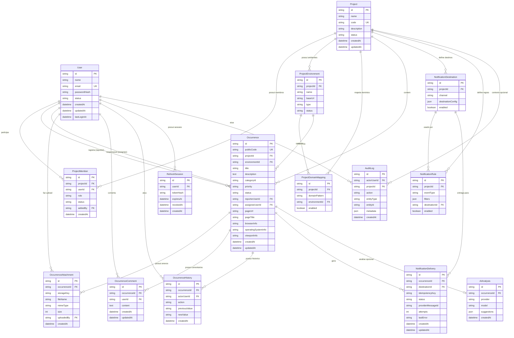
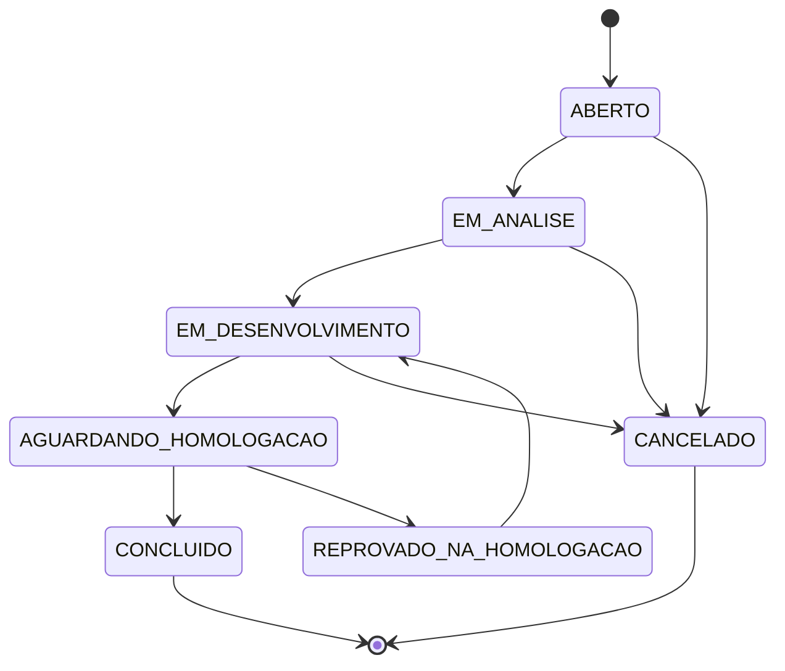

# Modelo de Dados

**Versão:** 1.1
**Data:** 21/11/2026
**Status:** Implementado (Prisma + migrações versionadas)

---

## 1. Objetivo

Documentar o modelo relacional alvo do QUALITY TEST, com diagrama entidade-relacionamento (ER) em Mermaid, descrição de cada entidade e regras de integridade, fiel à **seção 11** da especificação mestra.

> Modelo **implementado** em `apps/api/prisma/schema.prisma`, com migrações versionadas em `apps/api/prisma/migrations/`. Este documento descreve o modelo real; refinamentos futuros devem atualizar schema, migração e este documento.

---

## 2. Diagrama ER

---

## 3. Descrição das entidades

### 3.1 User

Usuário da plataforma. Uma única conta pode participar de vários projetos.

| Campo | Tipo | Regra |
|---|---|---|
| id | string | PK |
| name | string | Obrigatório |
| email | string | **Único** (UK) |
| passwordHash | string | Obrigatório; nunca armazenar senha em texto puro |
| status | enum | ATIVO / INATIVO (a confirmar nomenclatura) |
| createdAt | datetime | Obrigatório |
| updatedAt | datetime | Obrigatório |
| lastLoginAt | datetime | Nulo até o primeiro acesso |

### 3.2 Project

Projeto isolado, com seus próprios dados e configurações.

| Campo | Tipo | Regra |
|---|---|---|
| id | string | PK |
| name | string | Obrigatório |
| code | string | **Único** (UK); código/slug do projeto |
| description | string | Opcional |
| status | enum | ATIVO / INATIVO |
| createdAt | datetime | Obrigatório |
| updatedAt | datetime | Obrigatório |

> URLs de homologação/produção e ambientes residem em `ProjectEnvironment`. Gestor responsável, equipes e participantes derivam de `ProjectMember`. A especificação (seção 11) lista apenas os campos acima para `Project`.

### 3.3 ProjectMember

Associação muitos-para-muitos entre usuários e projetos, com papel/permissões por projeto.

| Campo | Tipo | Regra |
|---|---|---|
| id | string | PK |
| projectId | string | FK → Project |
| userId | string | FK → User |
| role | enum | ADMINISTRADOR / GESTOR / TESTADOR / DESENVOLVEDOR (perfil no projeto) |
| status | enum | ATIVO / INATIVO (status do vínculo) |
| addedBy | string | FK → User (quem concedeu o acesso) |
| createdAt | datetime | Data de inclusão |

**Restrição:** `unique(projectId, userId)` — o mesmo usuário aparece no máximo uma vez por projeto.

### 3.4 ProjectEnvironment

Ambientes e URLs por projeto.

| Campo | Tipo | Regra |
|---|---|---|
| id | string | PK |
| projectId | string | FK → Project |
| name | string | Rótulo do ambiente |
| baseUrl | string | URL base |
| type | enum | development / testing / staging / production |
| status | enum | ATIVO / INATIVO |

### 3.5 ProjectDomainMapping

Mapeamento de domínio/URL para projeto, usado pela extensão para sugerir o projeto.

| Campo | Tipo | Regra |
|---|---|---|
| id | string | PK |
| projectId | string | FK → Project |
| domainPattern | string | Domínio ou padrão de URL |
| environmentId | string | FK → ProjectEnvironment |
| enabled | boolean | Habilita/desabilita o mapeamento |

### 3.6 Occurrence

Ocorrência/bug. Todo campo técnico é coletado apenas quando disponível e permitido.

| Campo | Tipo | Regra |
|---|---|---|
| id | string | PK |
| publicCode | string | **Único** (UK); código legível (ex.: QT-000125) |
| projectId | string | FK → Project |
| environmentId | string | FK → ProjectEnvironment (opcional) |
| title | string | Obrigatório |
| description | text | Descrição detalhada |
| categoryId | string | Referência à categoria (ver observação 4.1) |
| priority | enum | CRITICA / ALTA / MEDIA / BAIXA |
| status | enum | Ver seção 5.4 |
| reporterUserId | string | FK → User; autor determinado pelo servidor |
| assigneeUserId | string | FK → User (responsável; opcional) |
| pageUrl | string | URL da página |
| pageTitle | string | Título da página |
| browserInfo | string | Navegador e versão, quando disponível |
| operatingSystemInfo | string | SO, quando disponível de forma confiável |
| viewportInfo | string | Resolução/dimensões, quando disponível |
| createdAt | datetime | Data/hora do servidor |
| updatedAt | datetime | Data/hora do servidor |

### 3.7 OccurrenceAttachment

Anexos (screenshot principal e anexos adicionais).

| Campo | Tipo | Regra |
|---|---|---|
| id | string | PK |
| occurrenceId | string | FK → Occurrence |
| storageKey | string | Chave no storage S3 |
| fileName | string | Nome do arquivo |
| mimeType | string | Validado |
| size | int | Validado |
| uploadedBy | string | FK → User |
| createdAt | datetime | Data/hora |

### 3.8 OccurrenceComment

Comentários na ocorrência.

| Campo | Tipo | Regra |
|---|---|---|
| id | string | PK |
| occurrenceId | string | FK → Occurrence |
| userId | string | FK → User |
| content | text | Conteúdo |
| createdAt | datetime | Data/hora |
| updatedAt | datetime | Data/hora |

### 3.9 OccurrenceHistory

Histórico cronológico de alterações por ocorrência.

| Campo | Tipo | Regra |
|---|---|---|
| id | string | PK |
| occurrenceId | string | FK → Occurrence |
| actorUserId | string | FK → User |
| action | string | Ação realizada |
| previousValue | string | Valor anterior |
| newValue | string | Valor novo |
| createdAt | datetime | Data/hora do servidor |

### 3.10 NotificationDestination

Destino de notificação por projeto.

| Campo | Tipo | Regra |
|---|---|---|
| id | string | PK |
| projectId | string | FK → Project |
| channel | enum | whatsapp (inicial), e-mail/teams futuros |
| destinationConfig | json | Configuração **sem segredos em texto aberto** |
| enabled | boolean | Ativo/inativo |

### 3.11 NotificationRule

Regra que associa evento a destino.

| Campo | Tipo | Regra |
|---|---|---|
| id | string | PK |
| projectId | string | FK → Project |
| eventType | enum | Ex.: occurrence.created, occurrence.updated |
| filters | json | Filtros aplicáveis |
| destinationId | string | FK → NotificationDestination |
| enabled | boolean | Ativo/inativo |

### 3.12 NotificationDelivery

Registro de cada tentativa de entrega.

| Campo | Tipo | Regra |
|---|---|---|
| id | string | PK |
| occurrenceId | string | FK → Occurrence |
| destinationId | string | FK → NotificationDestination |
| idempotencyKey | string | Chave de idempotência por evento/destino |
| status | enum | PENDENTE / ENVIADO / FALHA / DESCARTADO |
| providerMessageId | string | ID retornado pelo provedor |
| attempts | int | Nº de tentativas |
| lastError | string | Último erro (sem credenciais) |
| createdAt | datetime | Data/hora |
| updatedAt | datetime | Data/hora |

### 3.13 AuditLog

Trilha de auditoria — **SOMENTE INSERÇÃO**. Não deve ser editável por usuários comuns. A imutabilidade é reforçada **no banco**: a função `qualitytest_block_audit_mutation()` e os triggers `audit_logs_no_update_delete` e `audit_logs_no_truncate` (migration `20261121010000_audit_logs_immutable`) bloqueiam `UPDATE`, `DELETE` e `TRUNCATE` na tabela.

| Campo | Tipo | Regra |
|---|---|---|
| id | string | PK |
| actorUserId | string | FK → User (autor da ação) |
| projectId | string | FK → Project; **nullable** para eventos globais |
| action | string | Tipo de ação |
| entityType | string | Tipo da entidade |
| entityId | string | Identificador da entidade |
| metadata | json | Valores anteriores/novos, sem segredos |
| createdAt | datetime | Data/hora do servidor |

### 3.14 RefreshSession

Sessão de atualização de token.

| Campo | Tipo | Regra |
|---|---|---|
| id | string | PK |
| userId | string | FK → User |
| tokenHash | string | Hash do refresh token (não armazenar token em claro) |
| expiresAt | datetime | Expiração |
| revokedAt | datetime | Revogação (nulo se ativa) |
| createdAt | datetime | Data/hora |

### 3.15 AIAnalysis (opcional)

Registro de sugestões de IA. Módulo opcional e desativável (`AI_ENABLED`, Etapa 9). Implementado no schema como `model AIAnalysis` (`@@map("ai_analyses")`, índice em `occurrenceId`, `onDelete: Restrict`).

| Campo | Tipo | Regra |
|---|---|---|
| id | string | PK (`cuid`) |
| occurrenceId | string | FK → Occurrence (Restrict) · indexado |
| provider | string | Provedor utilizado (ex.: `local-deterministic`; `disabled` quando desativado) |
| model | string | Modelo utilizado (ex.: `heuristic-v1`; `none` quando desativado) |
| suggestions | json | Lista de sugestões (`type`, `value`, `confidence`, `rationale`) — validada defensivamente na leitura |
| createdAt | datetime | Data/hora (`now()`) |

> Não armazenar segredos nem screenshots/dados sensíveis sem configuração, base legal e controles. O provedor recebe apenas título/descrição/classificação da ocorrência (nunca anexos). Detalhes em [ia-opcional.md](ia-opcional.md).

---

## 4. Observações e definições pendentes

### 4.1 Categoria

`Occurrence.categoryId` referencia uma categoria, mas a **seção 11 não enumera** uma entidade `Category`. A seção 5.2 exige que categorias sejam configuráveis sem alteração de código; a seção 2.1 menciona "categorias ou configurações específicas" por projeto.

- **Decisão pendente:** entidade `Category` global vs. por projeto — **PENDENTE DE DEFINIÇÃO**.
- Sugestão de refinamento: introduzir `Category` (global e/ou por projeto), mantendo `categoryId` em `Occurrence`.

### 4.2 Enums

Todos os enums abaixo derivam literalmente da especificação e devem ser confirmados na implementação:

- **Prioridade:** CRITICA, ALTA, MEDIA, BAIXA (seção 5.3).
- **Status da ocorrência (seção 5.4):** ABERTO, EM_ANALISE, EM_DESENVOLVIMENTO, AGUARDANDO_HOMOLOGACAO, REPROVADO_NA_HOMOLOGACAO, CONCLUIDO, CANCELADO.
- **Categoria (seção 5.2):** Erro funcional, Erro visual, Erro de integração, Erro de validação, Problema de desempenho, Problema de segurança, Acessibilidade, Compatibilidade, Outros.
- **Perfis (seção 3.2):** ADMINISTRADOR, GESTOR, TESTADOR, DESENVOLVEDOR.
- **Tipo de ambiente:** development, testing, staging, production.

---

## 5. Regras de integridade

1. **Foreign keys obrigatórias** para todas as relações descritas no ER.
2. **Unicidade:**
   - `User.email` único.
   - `Project.code` único.
   - `Occurrence.publicCode` único.
   - `ProjectMember (projectId, userId)` único.
3. **Índices para filtros frequentes:**
   - `Occurrence (projectId, status)`
   - `Occurrence (projectId, priority)`
   - `Occurrence (projectId, categoryId)`
   - `Occurrence (projectId, reporterUserId)`
   - `Occurrence (projectId, assigneeUserId)`
   - `Occurrence (projectId, createdAt)`
   - `OccurrenceHistory (occurrenceId, createdAt)`
   - `AuditLog (entityType, entityId)`, `AuditLog (projectId, createdAt)`
   - `NotificationDelivery (occurrenceId, destinationId, idempotencyKey)` — apoia a idempotência.
4. **Sem exclusão em cascata de histórico importante** — `OccurrenceHistory`, `AuditLog` e `NotificationDelivery` não devem ser apagados em cascata pela remoção de entidades-pai. A auditoria deve ser preservada.
5. **Desativação lógica (soft delete)** quando apropriado — preferir `status = INATIVO` a exclusão física para `User`, `Project`, `ProjectMember`, `NotificationDestination`, `NotificationRule`.
6. **Nunca confiar em `projectId` enviado pelo cliente** — validar `ProjectMember` e permissão no backend antes de qualquer leitura/escrita.
7. **Isolamento por projeto** — avaliar e testar a estratégia de isolamento, incluindo testes automatizados de autorização.
8. **Imutabilidade da auditoria no banco** — `audit_logs` é somente inserção. Além de a aplicação não expor edição/remoção, um trigger PostgreSQL (`qualitytest_block_audit_mutation`) bloqueia `UPDATE`, `DELETE` e `TRUNCATE` por acesso direto (SQL/operacional), garantindo a integridade da trilha mesmo fora da aplicação.

---

## 6. Diagrama de ciclo de vida do status da ocorrência

Transições **controladas por regras de negócio e permissões**, registrando autor, data, status anterior, status novo e justificativa quando necessária (seção 5.4).

> As transições acima são uma **proposta de fluxo**. As regras exatas de quem pode transicionar para cada estado devem ser definidas em conjunto com a matriz de permissões ([permissoes-e-isolamento.md](permissoes-e-isolamento.md)) — PENDENTE DE DEFINIÇÃO.

---

## 7. Referências

- Especificação mestra, seções 2, 5, 11.
- [permissoes-e-isolamento.md](permissoes-e-isolamento.md)
- [contratos-api.md](contratos-api.md)
- [notificacoes-whatsapp.md](notificacoes-whatsapp.md)
