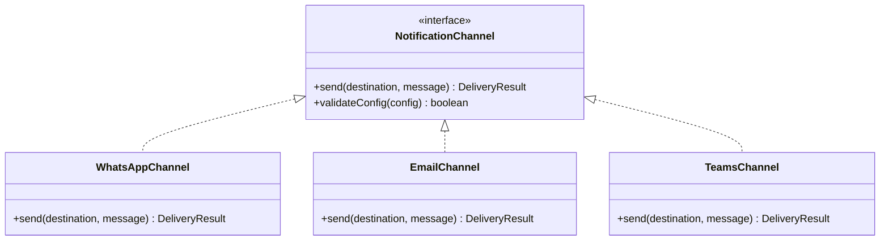
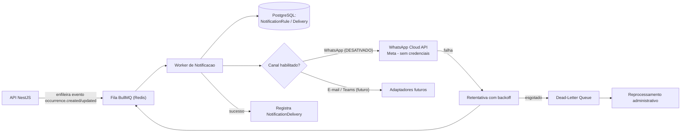
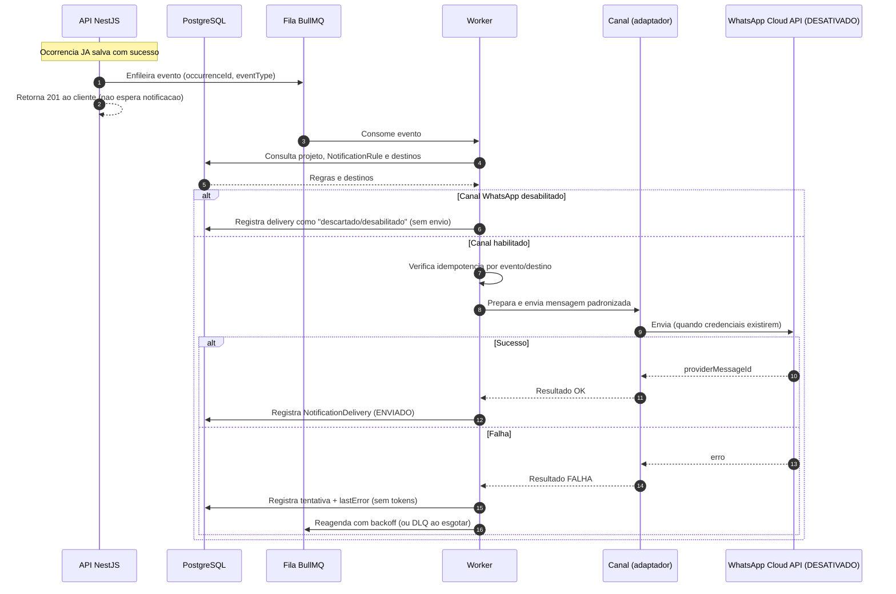

# Notificações e WhatsApp

**Versão:** 1.0
**Data:** 21/11/2026
**Status:** Planejado (não implementado)

---

## 1. Objetivo

Descrever o serviço desacoplado de notificação do QUALITY TEST, com foco no canal WhatsApp, suas responsabilidades, resiliência, adaptadores de canal e **limitações atuais**. Fiel à **seção 7** da especificação mestra.

> Conteúdo **Planejado**.
> **Estado atual do canal WhatsApp: DESATIVADO** por ausência de credenciais oficiais.

---

## 2. Princípio fundamental

O WhatsApp é um **canal de notificação**. O registro oficial, o histórico e o ciclo de vida das ocorrências permanecem no Quality Test. A indisponibilidade do WhatsApp **não pode** impedir o cadastro ou a consulta de ocorrências (seção 1).

O componente de WhatsApp é um serviço **desacoplado do núcleo**.

---

## 3. Responsabilidades do serviço de notificação (seção 7)

- Receber evento de ocorrência criada/atualizada.
- Consultar projeto e regras de notificação.
- Preparar mensagem padronizada.
- Enviar para destinos autorizados e tecnicamente suportados.
- Registrar tentativa, resposta e status disponível.
- Tratar falhas e retentativas.
- Evitar mensagens duplicadas.
- Disponibilizar histórico de notificações.

---

## 4. Exemplo de mensagem (seção 7)

```text
QUALITY TEST — NOVA OCORRÊNCIA
Código: QT-000125
Projeto: Intranet Maricá
Categoria: Erro visual
Prioridade: Alta
Título: Componente desalinhado na página de cadastro
Registrado por: <nome do usuário>
Ambiente: Homologação
Data: <data/hora>
Acesse: <link autenticado para a ocorrência>
```

> O link para a ocorrência deve ser autenticado. Nunca incluir tokens, cookies ou segredos na mensagem.

---

## 5. Resiliência (seção 7.2)

- A ocorrência deve ser **salva antes** da tentativa de notificação.
- **Falha no WhatsApp não pode desfazer o registro.**
- Usar **fila assíncrona**.
- Implementar **retentativas com backoff**.
- Implementar **dead-letter queue (DLQ)** ou mecanismo equivalente.
- Registrar erros **sem expor tokens**.
- Permitir **reprocessamento administrativo**.
- Implementar **idempotência por evento/destino**.
- **Exibir situação da notificação.**

---

## 6. Adaptadores de canal (seção 7.3)

Criar uma **interface de canal de notificação** para permitir adicionar futuramente **e-mail, Microsoft Teams** ou outros canais, sem acoplar a regra de negócio à Meta.



> `EmailChannel` e `TeamsChannel` são **planejados/futuros** e não implementados nesta versão.

---

## 7. Limitações atuais do WhatsApp

Conforme a seção 7.1, **antes de implementar qualquer fluxo** é obrigatório verificar a documentação oficial vigente:

- Elegibilidade da conta.
- Limitações de grupos.
- Regras de **templates**.
- Janela de atendimento.
- Webhooks e permissões.

**Regras explícitas:**

- Priorizar a **WhatsApp Business Platform / Cloud API oficial da Meta**.
- **Não presumir** que a API oficial permita enviar mensagens a **qualquer grupo preexistente**.
- A possibilidade de uso da **Groups API**, seus requisitos e limites deve ser **verificada diretamente na documentação oficial no momento da implementação**.
- **Não utilizar automação não oficial do WhatsApp Web** como dependência obrigatória ou caminho de produção.
- Se grupos existentes não forem suportados, oferecer alternativas autorizadas: **destinatários individuais**, grupos oficialmente elegíveis, ou outros canais corporativos. O painel deve permitir **configurar destinos por projeto**.

> **Estado:** canal WhatsApp **desativado**. Nenhuma mensagem é enviada. A especificação prevê que a notificação "pode permanecer desativada até haver credenciais oficiais" (critério de aceite nº 10).

---

## 8. Diagrama de filas e workers



---

## 9. Diagrama de sequência — notificação



---

## 10. Idempotência e evitamento de duplicidade

- Cada tentativa é amarrada a uma **`idempotencyKey` por evento/destino** (`NotificationDelivery.idempotencyKey`).
- Reenvios com a mesma chave **não geram entrega duplicada**.
- Retentativa **não duplica notificação** (ver cenário obrigatório na [plano-de-testes.md](plano-de-testes.md)).

---

## 11. Pontos pendentes de definição

- Credenciais oficiais da WhatsApp Business Platform / Cloud API (Meta) — **PENDENTE DE DEFINIÇÃO**.
- Elegibilidade da conta e suporte a grupos — **PENDENTE DE DEFINIÇÃO** (verificar doc oficial na implementação).
- Templates aprovados e política de janela de atendimento — **PENDENTE DE DEFINIÇÃO**.
- Destinos autorizados por projeto — **PENDENTE DE DEFINIÇÃO**.
- Provedor de e-mail/Teams (futuro) — **PENDENTE DE DEFINIÇÃO**.

---

## 12. Referências

- Especificação mestra, seções 1, 7, 11, 16.
- [contratos-api.md](contratos-api.md)
- [modelo-de-dados.md](modelo-de-dados.md)
- [riscos-e-dependencias.md](riscos-e-dependencias.md)
