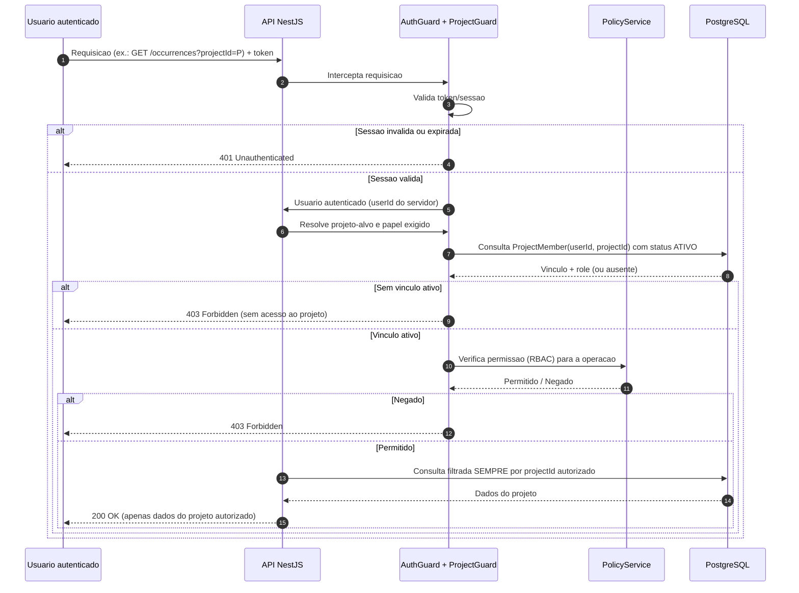

# Permissões e Isolamento por Projeto

**Versão:** 1.0
**Data:** 21/11/2026
**Status:** Planejado (não implementado)

---

## 1. Objetivo

Definir o modelo de autorização do QUALITY TEST: **RBAC combinado com permissões por projeto**, a matriz de permissões por recurso × papel e a **estratégia de isolamento por projeto**. Fiel às seções 2.2, 2.3 e 3.2 da especificação mestra.

> Conteúdo **Planejado**. Representa o modelo alvo.

---

## 2. Princípios de autorização

1. **RBAC + permissões por projeto.** Não confiar apenas no papel global do usuário. O acesso é decidido pelo papel do usuário **naquele projeto** (`ProjectMember.role`).
2. **Autorização validada no backend em toda operação.** O filtro visual no frontend não é suficiente.
3. **Administrador global** consulta todos os projetos; os demais usuários só acessam projetos aos quais estejam vinculados e para os quais tenham permissão.
4. **Autor principal determinado no servidor** a partir da identidade autenticada — nunca aceitar `userId` do cliente.
5. **Menor privilégio** em todas as decisões.

---

## 3. Perfis (seção 3.2)

| Perfil | Escopo | Resumo de capacidades |
|---|---|---|
| **ADMINISTRADOR** | Global | Gerencia configurações globais; cadastra/administra usuários; cria, edita, ativa e desativa projetos; gerencia associações e permissões; configura integrações e notificações; consulta todos os projetos e relatórios; acessa auditoria. |
| **GESTOR** | Por projeto | Atua nos projetos aos quais possui acesso; gerencia ocorrências e responsáveis; acompanha equipes, indicadores e relatórios; pode administrar membros do projeto **somente se receber essa permissão**. |
| **TESTADOR** | Por projeto | Registra ocorrências; anexa capturas e evidências; consulta e acompanha ocorrências dos projetos autorizados; comenta e complementa conforme permissão. Não eleva privilégios nem administra usuários globalmente. |
| **DESENVOLVEDOR** | Por projeto | Consulta ocorrências dos projetos autorizados; atualiza ocorrências atribuídas/permitidas; registra análise técnica e comentários; atualiza status conforme fluxo autorizado. Não consulta projetos sem vínculo. |

---

## 4. Matriz de permissões (recurso × papel)

Legenda: **S** = Sim (permitido) · **N** = Não (negado) · **C** = Condicional (depende de permissão explícita no projeto / atribuição).

| Recurso / Operação | ADMINISTRADOR | GESTOR | TESTADOR | DESENVOLVEDOR |
|---|---|---|---|---|
| Configurações globais da plataforma | S | N | N | N |
| Cadastro/gestão de usuários globais | S | N | N | N |
| Criar/editar/ativar/desativar projetos | S | C | N | N |
| Consultar qualquer projeto | S | C | C | C |
| Gerenciar membros do projeto | S | C | N | N |
| Gerenciar ambientes e domínios do projeto | S | C | N | N |
| Configurar destinos/regras de notificação | S | C | N | N |
| Registrar ocorrência (projeto autorizado) | S | S | S | C |
| Editar ocorrência (título/descrição/categoria) | S | S | C | C |
| Comentar ocorrência | S | S | S | S |
| Anexar evidências | S | S | S | C |
| Atribuir/reatribuir responsável | S | S | N | N |
| Alterar status (conforme fluxo) | S | S | N | C |
| Alterar prioridade | S | S | N | C |
| Excluir/cancelar ocorrência | S | C | N | N |
| Exportar ocorrências/relatórios | S | C | C | C |
| Acessar dashboard global | S | N | N | N |
| Acessar dashboard do projeto | S | S | C | C |
| Acessar auditoria | S | C | N | N |
| Gerenciar IA (ativar/desativar) | S | N | N | N |

> A matriz acima é uma **proposta inicial** derivada dos papéis descritos na seção 3.2. As células marcadas **C** exigem definição precisa de quem concede a permissão — **PENDENTE DE DEFINIÇÃO** durante a implementação da ETAPA 3.

---

## 5. Estratégia de isolamento por projeto

O isolamento lógico deve ser aplicado de forma consistente em **todas as camadas** (seção 2.2): API, consultas ao banco, serviços de negócio, dashboard, listagens, pesquisa, exportações, relatórios, comentários, anexos, notificações e extensão do navegador.

### 5.1 Regras obrigatórias

1. **Validar `ProjectMember` no backend em toda operação.** Antes de executar qualquer ação sobre um recurso, o backend resolve o projeto do recurso e verifica se o usuário autenticado possui associação **ativa** (`status = ATIVO`) naquele projeto, com o papel necessário.
2. **Nunca confiar no `projectId` enviado pelo cliente.** O `projectId` recebido é tratado apenas como *intenção*; o backend valida o vínculo e a permissão. Jamais usar `projectId` do cliente como fonte de verdade para autorização.
3. **Filtro obrigatório por projeto** em:
   - Listagem e paginação de ocorrências;
   - Pesquisa (por código, título, descrição);
   - Exportações;
   - Relatórios e indicadores;
   - Comentários e anexos;
   - Notificações (destinos e regras);
   - Extensão (sugestão, seleção e envio).
4. **Escopo de dados por usuário.** Para perfis não-ADMINISTRADOR, toda consulta é restrita ao conjunto de projetos em que há vínculo ativo. O ADMINISTRADOR pode consultar todos.
5. **Anexos e storage.** O download só é liberado após validar o vínculo do usuário com o projeto da ocorrência; usar URLs assinadas com expiração.
6. **Dashboard.** Dashboard global apenas para ADMINISTRADOR; os demais perfis recebem dashboard limitado aos projetos autorizados. Não misturar dados de projetos sem acesso.

### 5.2 Padrão de aplicação (guards)

Proposta de dois mecanismos combinados:

- **AuthGuard** — valida a sessão/token e resolve o usuário autenticado.
- **ProjectGuard** — resolve o projeto-alvo (a partir do recurso ou do corpo) e verifica a associação ativa e o papel/permissão exigidos. Aplicado a toda rota dependente de projeto.

### 5.3 Testes de isolamento

Devem existir testes automatizados negativos garantindo que:
- Usuário sem vínculo não consulta ocorrências do projeto;
- Filtros não vazam dados entre projetos;
- Envio com projeto não autorizado é rejeitado;
- Anexos só são acessíveis a usuários autorizados;
- Exportações respeitam permissões.

---

## 6. Diagrama de sequência — autorização por projeto

---

## 7. Auditoria das decisões de acesso

Eventos relevantes de segurança (seção 10) devem ser registrados na trilha de auditoria, incluindo login/logout, alteração de permissões, inclusão/remoção de membros e tentativas de integração. Campos de auditoria conforme `AuditLog` em [modelo-de-dados.md](modelo-de-dados.md).

---

## 8. Referências

- Especificação mestra, seções 2.2, 2.3, 2.5, 3.2, 3.3, 9, 10, 14.
- [modelo-de-dados.md](modelo-de-dados.md)
- [contratos-api.md](contratos-api.md)
- [adr/ADR-0002-isolamento-por-projeto.md](adr/ADR-0002-isolamento-por-projeto.md)
