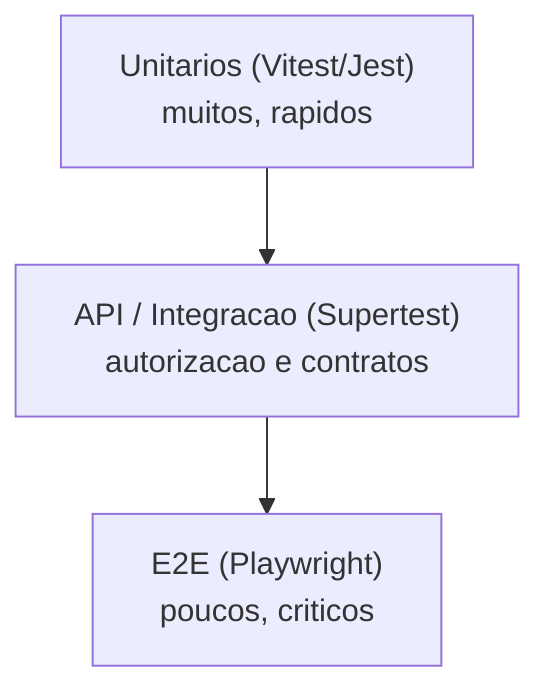

# Plano de Testes

**Versão:** 1.1
**Data:** 21/11/2026
**Status:** Implementado (estratégia executada; resultados em relatorio-de-testes.md)

---

## 1. Objetivo

Definir a estratégia de testes do QUALITY TEST, os níveis, as ferramentas e a lista **completa** de cenários obrigatórios e critérios de aceite do MVP, fiel à **seção 16** da especificação mestra.

> Estratégia **executada**. Os testes foram implementados e os resultados consolidados em [relatorio-de-testes.md](relatorio-de-testes.md). E2E de navegador (Playwright) e metas de cobertura estão **implementados** (ver seções 6.1 e 6.2).

---

## 2. Níveis de teste

| Nível | Escopo | Ferramentas (seção 12) |
|---|---|---|
| **Unitário** | Funções, serviços e regras isoladas | Vitest ou Jest (conforme compatibilidade) |
| **Integração** | Módulos + banco/redis em ambiente controlado | Vitest/Jest + Prisma |
| **API** | Endpoints REST, contratos e autorização | Supertest |
| **E2E** | Fluxos completos no navegador | Playwright |
| **Extensão** | Fluxos da extensão Chrome e integração | Testes de extensão e integração |

Tarefa de foco especial: **testes negativos de isolamento por projeto** (seção 5.3 de [permissoes-e-isolamento.md](permissoes-e-isolamento.md)).

---

## 3. Cenários obrigatórios (seção 16)

| # | Cenário obrigatório | Nível de teste | Status |
|---|---|---|---|
| 1 | Usuário sem login não acessa áreas protegidas | API / E2E | Planejado |
| 2 | Usuário só acessa projetos autorizados | API / Integração | Planejado |
| 3 | Um usuário pode participar de dois ou mais projetos com a mesma conta | Integração / E2E | Planejado |
| 4 | Usuário sem vínculo não consulta ocorrências do projeto | API / Integração | Planejado |
| 5 | Testador registra ocorrência no projeto correto | E2E / API | Planejado |
| 6 | Backend associa autor pelo usuário autenticado | Integração / API | Planejado |
| 7 | Envio com projeto não autorizado é rejeitado | API / Integração | Planejado |
| 8 | Filtros não vazam dados entre projetos | Integração / API | Planejado |
| 9 | Anexos só são acessíveis a usuários autorizados | API / Integração | Planejado |
| 10 | Alteração de status gera histórico | Integração / API | Planejado |
| 11 | Notificação não bloqueia criação da ocorrência | Integração | Planejado |
| 12 | Falha do WhatsApp não perde o registro | Integração | Planejado |
| 13 | Retentativa não duplica notificação | Integração | Planejado |
| 14 | Idempotência impede duplicação da ocorrência em reenvio | API / Integração | Planejado |
| 15 | Sugestão de projeto pela URL pode ser corrigida manualmente | E2E / Extensão | Planejado |
| 16 | Extensão funciona com sessão válida e trata sessão expirada | Extensão / E2E | Planejado |
| 17 | Exportações respeitam permissões | API / Integração | Planejado |

---

## 4. Critérios de aceite do MVP (seção 16)

| # | Critério de aceite | Status |
|---|---|---|
| 1 | Administrador consegue criar usuários e projetos | Planejado |
| 2 | Administrador consegue vincular um usuário a múltiplos projetos | Planejado |
| 3 | Testador consegue autenticar-se | Planejado |
| 4 | Testador consegue selecionar um projeto autorizado | Planejado |
| 5 | Testador consegue capturar/anexar screenshot e descrever o erro | Planejado |
| 6 | API salva ocorrência e atribui autor autenticado | Planejado |
| 7 | Usuário autorizado consulta a ocorrência | Planejado |
| 8 | Usuário não autorizado não acessa dados do projeto | Planejado |
| 9 | Histórico registra criação e mudanças relevantes | Planejado |
| 10 | A notificação é processada de forma assíncrona e pode permanecer desativada até haver credenciais oficiais | Planejado |

---

## 5. Pirâmide de testes (proposta)

**Diretrizes:**
- Base ampla de testes unitários (regras de negócio, validações, policies).
- Camada média de testes de integração/API com foco em **autorização e isolamento**.
- Topo enxuto de E2E cobrindo os fluxos críticos (login, registro de ocorrência, isolamento, homologação).

---

## 6. Matriz de cobertura por área

| Área | Unitário | Integração | API | E2E |
|---|---|---|---|---|
| Autenticação/sessões | Sim | Sim | Sim | Sim |
| Isolamento por projeto | Sim | Sim | Sim | Sim |
| Projetos/membros/ambientes/domínios | Sim | Sim | Sim | Sim |
| Ocorrências (CRUD, status, histórico) | Sim | Sim | Sim | Sim |
| Anexos/storage | - | Sim | Sim | Sim |
| Notificações/filas/idempotência | Sim | Sim | Sim | - |
| Relatórios/dashboard | Sim | Sim | Sim | Sim |
| Extensão Chrome | Sim | - | - | Sim |
| IA (opcional) | Sim | Sim | Sim | - |

### 6.1 Metas de cobertura

Percentuais mínimos definidos em `coverageThreshold` por workspace (`jest.config.js`). `npm test` coleta cobertura (`--coverage`) e **falha** quando a meta não é atingida.

| Workspace | Statements | Branches | Functions | Lines |
|---|---|---|---|---|
| `apps/api` | 80% | 55% | 75% | 80% |
| `apps/worker` | 85% | 65% | 80% | 85% |
| `apps/extension` | 90% | 80% | 90% | 90% |

> Metas calibradas ligeiramente abaixo da cobertura medida (API ~84% stmts, worker ~89% stmts, extensão ~100% no módulo de sessão) para barrar regressões sem quebrar o build por variações pequenas.

### 6.2 E2E de navegador (Playwright)

Suíte em `e2e/`, executada por `npm run test:e2e` (compila a extensão antes de rodar):

- **`web`** — frontend (`apps/web`) via `next dev`; valida renderização e validação do formulário de login.
- **`extension`** — extensão Chrome (MV3) carregada em contexto persistente (`--load-extension`), validando o registro do service worker e o popup sem sessão.

Pré-requisitos: `npm run test:e2e:install` (instala o Chromium do Playwright). Relatório: `npm run test:e2e:report`.

---

## 7. Critérios para considerar uma etapa "concluída"

Conforme a especificação (seção 0): não declarar uma etapa concluída apenas porque o código foi escrito. Ao final de cada etapa:

1. Executar os testes correspondentes.
2. Corrigir falhas.
3. Registrar o resultado.

---

## 8. Pontos pendentes de definição

- Escolha final entre Vitest e Jest por app — **RESOLVIDO**: Jest adotado em todos os workspaces (API, worker e extensão).
- Metas de cobertura — **RESOLVIDO** (ver seção 6.1).
- Estratégia de dados de teste (fixtures/seed) — **PENDENTE DE DEFINIÇÃO**.

---

## 9. Referências

- Especificação mestra, seções 12, 16, 17.
- [permissoes-e-isolamento.md](permissoes-e-isolamento.md)
- [plano-incremental.md](plano-incremental.md)
- [deploy-infraestrutura.md](deploy-infraestrutura.md)
