# Plano Incremental de Execução

**Versão:** 1.4
**Data:** 21/11/2026
**Status:** Em execução (Etapas 1 a 10 concluídas; Etapa 11 — Deploy em preparação; Etapa 12 — Documentação e Entrega concluída, exceto o PDF consolidado)

---

## 1. Objetivo

Detalhar as **12 etapas** do plano de execução (seção 19 da especificação mestra), com objetivo, entregáveis e critérios de aceite de cada etapa.

> **Estado atual:** **Etapa 10 — SEGURANÇA E QUALIDADE — Concluída** (headers de segurança via helmet, força mínima de `JWT_SECRET`, validação de extensão de anexos e revisão completa da seção 14; ver [seguranca-lgpd.md](seguranca-lgpd.md)). Pendências herdadas: credenciais oficiais da WhatsApp Cloud API — canal permanece desativado (seção 11 de [notificacoes-whatsapp.md](notificacoes-whatsapp.md)); domínio oficial da extensão e armazenamento seguro do token (seção 11 de [extensao-chrome.md](extensao-chrome.md)); E2E de navegador da Etapa 6. Pendências não bloqueantes desta etapa: política de retenção/LGPD, teste de restauração (aguarda provedor gerenciado) e atualização de dependências com breaking change. As Etapas 1 a 10 estão **Concluídas**. A **Etapa 11 — Deploy** está em **preparação**: foram versionados os artefatos de build (Dockerfiles da API e do worker, `.dockerignore`, scripts npm e job `docker-images` no CI) e os runbooks de migração/rollback e de backup/restauração; **nenhum ambiente de produção foi provisionado e nenhum deploy foi executado** — isso depende de autorização explícita e da definição de provedores/domínio/credenciais (ver [deploy-infraestrutura.md](deploy-infraestrutura.md)). A **Etapa 12 — Documentação e Entrega** foi executada: manuais por perfil, OpenAPI estático, runbooks, relatório de testes, checklist de aceite e lista de pendências conhecidas; o **PDF consolidado** permanece adiado (pendência P15 em [pendencias-conhecidas.md](pendencias-conhecidas.md)).

---

## 2. Visão geral do cronograma lógico

```mermaid
flowchart LR
    E1["1. Diagnostico e Arquitetura"] --> E2["2. Fundacao"] --> E3["3. Auth e Autorizacao"] --> E4["4. Projetos"]
    E4 --> E5["5. Ocorrencias"] --> E6["6. Frontend e Dashboard"] --> E7["7. Extensao Chrome"]
    E7 --> E8["8. Notificacoes"] --> E9["9. IA Opcional"] --> E10["10. Seguranca e Qualidade"]
    E10 --> E11["11. Deploy"] --> E12["12. Documentacao e Entrega"]
```

Regra transversal (seção 0): ao final de cada etapa, executar os testes correspondentes, corrigir falhas e registrar o resultado. **Não declarar uma etapa concluída apenas porque o código foi escrito.**

---

## 3. Detalhamento das etapas

### ETAPA 1 — DIAGNÓSTICO E ARQUITETURA

**Status:** Concluída

**Objetivo:** Inspecionar o repositório e o ambiente, e produzir a base arquitetural do produto.

**Entregáveis:**
- Diagnóstico do repositório e da branch atual.
- Arquitetura proposta e estrutura de diretórios.
- Diagrama C4 (contexto, containers, componentes).
- Modelo ER.
- RBAC e estratégia de isolamento por projeto.
- Contratos da API.
- Mapeamento de riscos e custos.
- Estratégia Vercel e serviços externos.
- ADRs iniciais.

**Critérios de aceite:**
- Documentação de arquitetura completa e coerente com a especificação.
- Modelo de dados, permissões e isolamento documentados.
- Riscos e dependências externas registrados.

---

### ETAPA 2 — FUNDAÇÃO

**Status:** Concluída (pendência: validação de migration/seed com Docker não executada)

**Objetivo:** Preparar a base técnica do monorepositório.

**Entregáveis:** Monorepositório; TypeScript strict; lint e format; configuração de ambiente; Docker Compose para desenvolvimento; PostgreSQL e Redis; CI inicial; migrações e seed apenas para desenvolvimento.

**Critérios de aceite:** Build/lint/typecheck executando; serviços de dev subindo via Docker; CI inicial verde; migrations de desenvolvimento aplicáveis.

---

### ETAPA 3 — AUTENTICAÇÃO E AUTORIZAÇÃO

**Status:** Concluída

**Objetivo:** Implementar identidade, sessões e controle de acesso.

**Entregáveis:** Usuários; sessões; perfis; membership por projeto; guards e policies; testes negativos de isolamento.

**Critérios de aceite:** Login/logout/refresh funcionando; usuário só acessa projetos autorizados; testes negativos de isolamento verdes.

---

### ETAPA 4 — PROJETOS

**Status:** Concluída

**Objetivo:** Implementar o módulo de projetos.

**Entregáveis:** CRUD de projetos; ambientes; domínios; membros; regras de acesso; testes multi-projeto.

**Critérios de aceite:** Administrador cria/edita/ativa/desativa projetos; um usuário vinculado a múltiplos projetos; testes multi-projeto verdes.

---

### ETAPA 5 — OCORRÊNCIAS

**Status:** Concluída

**Objetivo:** Implementar o núcleo de ocorrências.

**Entregáveis:** Cadastro; listagem; detalhes; anexos; comentários; status; histórico; auditoria.

**Critérios de aceite:** Ocorrência criada com autor atribuído pelo servidor; histórico e auditoria registrados; alteração de status gera histórico.

---

### ETAPA 6 — FRONTEND E DASHBOARD

**Status:** Concluída (pendência: E2E de navegador ponta a ponta)

**Objetivo:** Construir a interface e os indicadores.

**Entregáveis:** Telas; filtros; relatórios; estados de interface; testes E2E.

**Critérios de aceite:** Telas mínimas navegáveis; indicadores respeitam escopo; E2E dos fluxos críticos verdes.

---

### ETAPA 7 — EXTENSÃO CHROME

**Status:** Concluída (pendências: domínio oficial e armazenamento seguro do token)

**Objetivo:** Permitir registro de ocorrência durante a navegação.

**Entregáveis:** Login; captura; recorte/anotação (se viável); sugestão de projeto por domínio; seleção manual; envio idempotente; tratamento de falhas.

**Critérios de aceite:** Extensão registra ocorrência com sessão válida; trata sessão expirada; sugestão de projeto corrigível.

---

### ETAPA 8 — NOTIFICAÇÕES

**Status:** Concluída (pendência: credenciais oficiais do WhatsApp — canal desativado)

**Objetivo:** Implementar o serviço desacoplado de notificação.

**Entregáveis:** Filas; worker; adaptador de canais; WhatsApp oficial após validação de elegibilidade e credenciais; histórico e retentativas.

**Critérios de aceite:** Notificação assíncrona não bloqueia criação; falha do WhatsApp não perde registro; retentativa não duplica; canal pode permanecer desativado sem credenciais. **Atendidos** (9 testes unitários do worker + 19 E2E da API).

---

### ETAPA 9 — IA OPCIONAL

**Status:** Concluída (pendência: provider externo previsto no contrato, porém não conectado)

**Objetivo:** Oferecer sugestões assistivas.

**Entregáveis:** Classificação sugerida; duplicidade; resumo; validação humana; controles de privacidade.

**Critérios de aceite:** Sugestões exibidas como geradas por IA; exigência de confirmação humana; funcionalidade desativável. **Atendidos** (11 testes unitários do provider + 9 E2E da API = 20; ver [ia-opcional.md](ia-opcional.md)).

---

### ETAPA 10 — SEGURANÇA E QUALIDADE

**Status:** Concluída (pendências: política de retenção/LGPD e teste de restauração dependem de definição externa)

**Objetivo:** Revisar e endurecer segurança e qualidade.

**Entregáveis:** Testes completos; revisão de autorização; revisão de upload; revisão de secrets; testes de recuperação; correções.

**Critérios de aceite:** Testes de isolamento e segurança verdes; uploads validados; secrets geridos; restauração testada. **Atendidos** — testes de isolamento/segurança verdes (191 na API); upload com MIME + extensão + tamanho; `JWT_SECRET` com força mínima; headers de segurança (helmet); runbook de backup/restauração documentado (execução pendente do provedor). Detalhes em [seguranca-lgpd.md](seguranca-lgpd.md).

---

### ETAPA 11 — DEPLOY

**Status:** Em preparação (artefatos de build versionados; **deploy de produção não executado**)

**Objetivo:** Preparar e executar implantação controlada.

**Entregáveis:** Preview; configuração de produção; migrações controladas; monitoramento; backup; rollback. **Produção somente após autorização.**

**Resultado parcial:**
- `docker/api.Dockerfile` e `docker/worker.Dockerfile` (build multi-stage, validados localmente).
- `.dockerignore` da raiz (contexto enxuto, sem segredos).
- Scripts `docker:build`, `docker:build:api`, `docker:build:worker`.
- Job `docker-images` no CI (valida o build das imagens a cada push/PR; não publica).
- Runbooks de migração (`prisma migrate deploy`) e de rollback, além de backup/restauração, em [deploy-infraestrutura.md](deploy-infraestrutura.md).

**Critérios de aceite:** Preview validado; pipeline de CI/CD bloqueando merges inválidos; produção somente com autorização explícita. **Pendente** de provedores, domínio e credenciais.

---

### ETAPA 12 — DOCUMENTAÇÃO E ENTREGA

**Status:** Concluída (pendência: PDF consolidado — P15)

**Objetivo:** Consolidar a entrega.

**Entregáveis:** Atualização de todos os diagramas; manuais; OpenAPI; runbooks; PDF consolidado; checklist de aceite; relatório de testes; lista de pendências conhecidas.

**Resultado:**
- **Manuais por perfil** (seção 17.4): [manuais/administrador.md](../manuais/administrador.md), [gestor.md](../manuais/gestor.md), [testador.md](../manuais/testador.md), [desenvolvedor.md](../manuais/desenvolvedor.md) e [extensao-chrome.md](../manuais/extensao-chrome.md).
- **OpenAPI estático:** [api/openapi.json](../api/openapi.json), gerado por `npm run docs:openapi` (offline, com `PrismaService` substituído por stub).
- **Runbooks:** [runbook-operacao.md](runbook-operacao.md) e [deploy-infraestrutura.md](deploy-infraestrutura.md) §8.
- **Relatório de testes:** [relatorio-de-testes.md](relatorio-de-testes.md).
- **Checklist de aceite (seção 22):** [checklist-de-aceite.md](checklist-de-aceite.md).
- **Pendências conhecidas:** [pendencias-conhecidas.md](pendencias-conhecidas.md) (P1–P18).
- **Diagramas/documentos revisados** para o estado real (índice em [docs/README.md](../README.md)).
- **PDF consolidado:** adiado — requer ferramenta adequada sem comprometer a editabilidade dos fontes Markdown.

**Critérios de aceite:** Documentação reflete o sistema implementado; manuais por perfil entregues; pendências registradas. **Atendidos**, exceto o PDF consolidado.

---

## 4. Quadro resumo

| Etapa | Nome | Status |
|---|---|---|
| 1 | Diagnóstico e Arquitetura | Concluída |
| 2 | Fundação | Concluída |
| 3 | Autenticação e Autorização | Concluída |
| 4 | Projetos | Concluída |
| 5 | Ocorrências | Concluída |
| 6 | Frontend e Dashboard | Concluída (pendência: E2E de navegador) |
| 7 | Extensão Chrome | Concluída (pendências: domínio oficial e armazenamento do token) |
| 8 | Notificações | Concluída (pendência: credenciais do WhatsApp — canal desativado) |
| 9 | IA Opcional | Concluída (pendência: provider externo não conectado) |
| 10 | Segurança e Qualidade | Concluída (pendências: retenção/LGPD e teste de restauração) |
| 11 | Deploy | Em preparação (artefatos prontos; deploy não executado) |
| 12 | Documentação e Entrega | Concluída (pendência: PDF consolidado) |

---

## 5. Referências

- Especificação mestra, seções 0, 19, 21.
- [plano-de-testes.md](plano-de-testes.md)
- [deploy-infraestrutura.md](deploy-infraestrutura.md)
- [riscos-e-dependencias.md](riscos-e-dependencias.md)
