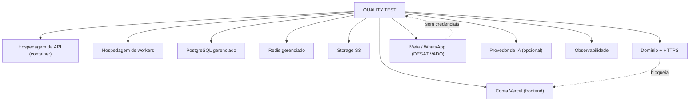

# Riscos, Custos e Dependências Externas

**Versão:** 1.0
**Data:** 21/11/2026
**Status:** Planejado (não implementado)

---

## 1. Objetivo

Registrar os riscos, os custos estimados e as dependências externas do QUALITY TEST, conforme a **seção 21, item 14** ("Riscos, custos e dependências externas").

> Conteúdo **Planejado**. Nenhum valor de custo é inventado: onde não houver dado, registra-se **"a levantar"**.

---

## 2. Riscos

Escalas: **Impacto** (Alto/Médio/Baixo) · **Probabilidade** (Alta/Média/Baixa).

| # | Risco | Impacto | Probabilidade | Mitigação |
|---|---|---|---|---|
| R1 | Vazamento de dados entre projetos (falha de isolamento) | Alto | Média | Validação obrigatória de `ProjectMember` no backend; guards; testes negativos de isolamento (ver [permissoes-e-isolamento.md](permissoes-e-isolamento.md)) |
| R2 | WhatsApp oficial não suportar grupos preexistentes ou exigir aprovação prolongada | Alto | Alta | Canal desacoplado e desativável; usar destinatários individuais/grupos elegíveis/outros canais; verificar doc oficial na implementação |
| R3 | Automação não oficial do WhatsApp banindo contas | Alto | Média | Não usar automação não oficial em produção (regra explícita da spec) |
| R4 | Incompatibilidade de execução da API/workers no modelo serverless da Vercel | Médio | Média | Executar API em container e workers em infraestrutura de processos contínuos |
| R5 | Dados sensíveis vazando em screenshots | Alto | Média | Orientação de revisão antes do envio; recorte/ocultação; regras LGPD |
| R6 | Exposição de credenciais em logs ou no código | Alto | Baixa | Gestão de secrets; logs sem credenciais; revisão de segurança |
| R7 | Indisponibilidade de serviços externos (Storage/Redis/Postgres) | Médio | Média | Serviços gerenciados; retentativas; monitoramento; backups |
| R8 | Crescimento do escopo ("telas aleatórias" antes da fundação) | Médio | Média | Execução incremental conforme plano de 12 etapas |
| R9 | Aumento de custo de IA/token sem controle | Médio | Média | IA opcional, desativável e com limites a definir |
| R10 | Perda de dados por ausência de backups testados | Alto | Baixa | Backups e restauração testada (seção 14) |
| R11 | Sessão expirada na extensão interrompendo o trabalho do testador | Baixo | Alta | Renovação segura de sessão; mensagens claras; fila local temporária |
| R12 | Ausência de domínio/HTTPS bloqueando deploy e extensão | Médio | Média | Tratar como pendência; configurar quando o domínio for fornecido |

---

## 3. Dependências externas pendentes

| Dependência | Descrição | Estado |
|---|---|---|
| **Meta / WhatsApp** | WhatsApp Business Platform / Cloud API oficial, elegibilidade e credenciais | PENDENTE DE DEFINIÇÃO |
| **Storage S3** | Bucket S3-compatível para screenshots e anexos | PENDENTE DE DEFINIÇÃO |
| **PostgreSQL** | Instância gerenciada | PENDENTE DE DEFINIÇÃO |
| **Redis** | Instância gerenciada (fila/cache) | PENDENTE DE DEFINIÇÃO |
| **Domínio** | Domínio oficial + HTTPS | PENDENTE DE DEFINIÇÃO |
| **Conta Vercel** | Conta/projeto Vercel vinculado ao repositório | PENDENTE DE DEFINIÇÃO |
| **Provedor de IA (opcional)** | Provedor para sugestões assistivas + base legal | PENDENTE DE DEFINIÇÃO |
| **Observabilidade** | Solução de logs/monitoramento | PENDENTE DE DEFINIÇÃO |
| **Identidade corporativa (SSO)** | Avaliar SSO/domínio corporativo | PENDENTE DE DEFINIÇÃO |

---

## 4. Custos estimados por serviço

> **Nenhum valor inventado.** Onde não há dado coletado, registrar "a levantar".

| Serviço | Modelo de custo | Estimativa |
|---|---|---|
| Vercel (frontend) | Por uso/plano | A levantar |
| Hospedagem da API (container) | Por instância/uso | A levantar |
| Hospedagem dos workers BullMQ | Por instância/processo contínuo | A levantar |
| PostgreSQL gerenciado | Por instância/armazenamento | A levantar |
| Redis gerenciado | Por instância/uso | A levantar |
| Storage S3 | Por armazenamento/tráfego | A levantar |
| WhatsApp Cloud API (Meta) | Por conversa/mensagem (confirmar na doc oficial) | A levantar |
| Provedor de IA (opcional) | Por token/uso | A levantar |
| Observabilidade | Por volume de logs/métricas | A levantar |
| Domínio | Anual (registro) | A levantar |

> Os valores dependem dos provedores escolhidos, tamanho da equipe e volume de uso — **PENDENTE DE DEFINIÇÃO**.

---

## 5. Diagrama de dependências

---

## 6. Referências

- Especificação mestra, seções 7, 13, 14, 21 (item 14).
- [deploy-infraestrutura.md](deploy-infraestrutura.md)
- [notificacoes-whatsapp.md](notificacoes-whatsapp.md)
