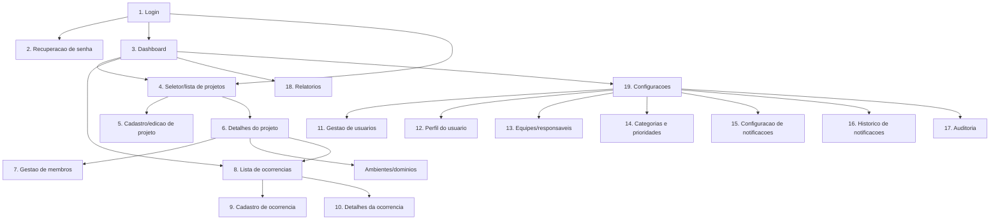
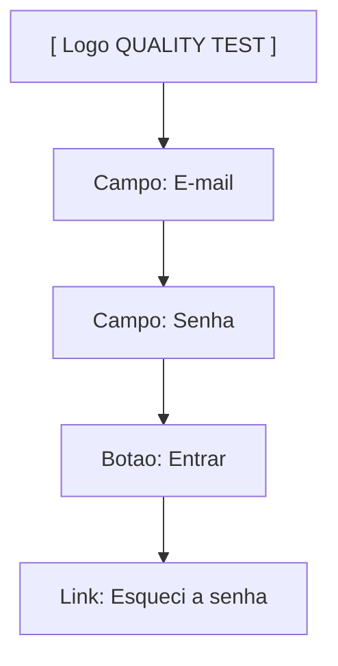
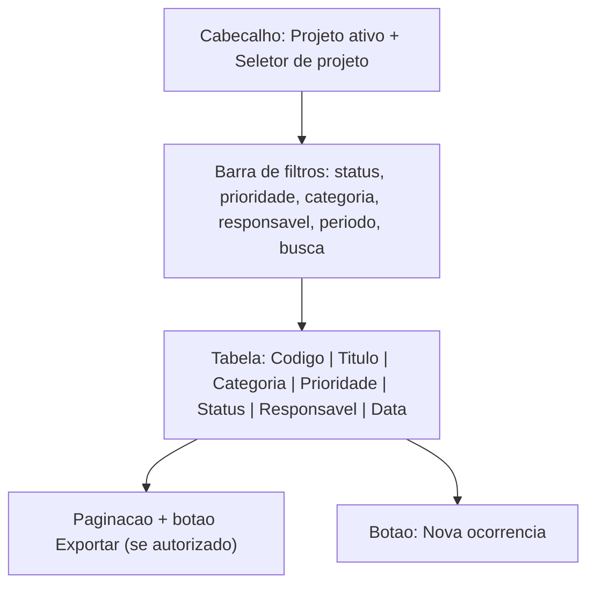
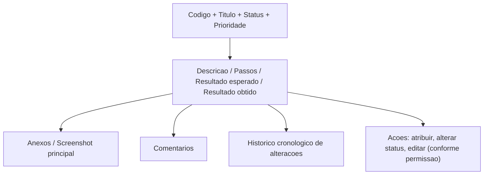
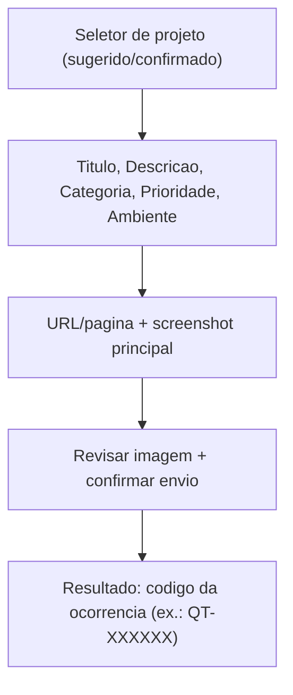

# Sitemap e Telas

**Versão:** 1.0
**Data:** 21/11/2026
**Status:** Planejado (não implementado)

---

## 1. Objetivo

Apresentar o sitemap, o diagrama de navegação, a lista das **19 telas mínimas** (seção 15 da especificação), a **matriz de telas por perfil** e wireframes descritivos simples.

> Conteúdo **Planejado**. As telas ainda não existem. Os wireframes são descritivos (texto/Mermaid), sem valores reais.

---

## 2. Diagrama de navegação (Mermaid)

---

## 3. Telas mínimas (seção 15)

| # | Tela | Descrição resumida |
|---|---|---|
| 1 | Login | Autenticação do usuário |
| 2 | Recuperação de senha | Solicitar/redefinir senha |
| 3 | Dashboard | Indicadores respeitando escopo de acesso |
| 4 | Seletor/lista de projetos | Escolha do projeto ativo |
| 5 | Cadastro/edição de projeto | Formulário de projeto |
| 6 | Detalhes do projeto | Visão do projeto, membros, ambientes, domínios |
| 7 | Gestão de membros do projeto | Adicionar/editar/remover membros e papéis |
| 8 | Lista de ocorrências | Tabela com filtros e paginação |
| 9 | Cadastro de ocorrência | Formulário de nova ocorrência |
| 10 | Detalhes da ocorrência | Dados, comentários, anexos, histórico, status |
| 11 | Gestão de usuários | Administração de usuários |
| 12 | Perfil do usuário | Dados e senha do próprio usuário |
| 13 | Equipes/responsáveis | Se adotados |
| 14 | Categorias e prioridades | Configuração (se aplicável) |
| 15 | Configuração de notificações | Destinos e regras por projeto |
| 16 | Histórico de notificações | Entregas e situações |
| 17 | Auditoria | Consulta de eventos de auditoria |
| 18 | Relatórios | Indicadores e exportações autorizadas |
| 19 | Configurações | Configurações gerais |

> As telas **13 (Equipes/responsáveis)** e **14 (Categorias e prioridades)** são condicionais ("se adotados"/"se aplicável") — a adoção é **PENDENTE DE DEFINIÇÃO**.

---

## 4. Matriz de telas por perfil de acesso

Legenda: **S** = acesso · **C** = condicional (requer permissão explícita) · **—** = sem acesso.

| Tela | ADMINISTRADOR | GESTOR | TESTADOR | DESENVOLVEDOR |
|---|---|---|---|---|
| 1. Login | S | S | S | S |
| 2. Recuperação de senha | S | S | S | S |
| 3. Dashboard | S (global) | S (projetos) | C | C |
| 4. Seletor/lista de projetos | S (todos) | S (autorizados) | S (autorizados) | S (autorizados) |
| 5. Cadastro/edição de projeto | S | C | — | — |
| 6. Detalhes do projeto | S | S | C | C |
| 7. Gestão de membros | S | C | — | — |
| 8. Lista de ocorrências | S | S | S | S |
| 9. Cadastro de ocorrência | S | S | S | C |
| 10. Detalhes da ocorrência | S | S | S | S |
| 11. Gestão de usuários | S | — | — | — |
| 12. Perfil do usuário | S | S | S | S |
| 13. Equipes/responsáveis | S | C | — | — |
| 14. Categorias e prioridades | S | C | — | — |
| 15. Configuração de notificações | S | C | — | — |
| 16. Histórico de notificações | S | C | C | — |
| 17. Auditoria | S | C | — | — |
| 18. Relatórios | S | S | C | C |
| 19. Configurações | S | C | — | — |

---

## 5. Wireframes descritivos (simples)

### 5.1 Login (tela 1)

### 5.2 Lista de ocorrências (tela 8)

### 5.3 Detalhes da ocorrência (tela 10)

### 5.4 Cadastro de ocorrência (tela 9)

> Os wireframes são descritivos e não representam layout final. Design detalhado será definido na ETAPA 6.

---

## 6. Diretrizes de UX (seção 15)

Navegação lateral; dashboard claro; seletor de projeto sempre evidente quando necessário; indicação do projeto ativo nas telas; tabelas com filtros e paginação; formulários objetivos; feedback de sucesso e erro; skeleton loading; estados vazios; confirmação para ações destrutivas; acessibilidade e navegação por teclado; tema claro e escuro (se viável); layout responsivo.

---

## 7. Pontos pendentes de definição

- Adoção das telas 13 (Equipes) e 14 (Categorias/prioridades) — **PENDENTE DE DEFINIÇÃO**.
- Tema claro/escuro — **PENDENTE DE DEFINIÇÃO** ("se viável").
- Wireframes de alta fidelidade — a produzir na ETAPA 6.

---

## 8. Referências

- Especificação mestra, seções 9, 15, 17.1.
- [permissoes-e-isolamento.md](permissoes-e-isolamento.md)
- [arquitetura-geral.md](arquitetura-geral.md)
